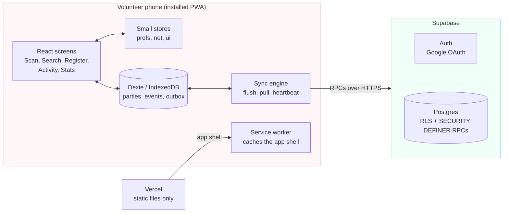
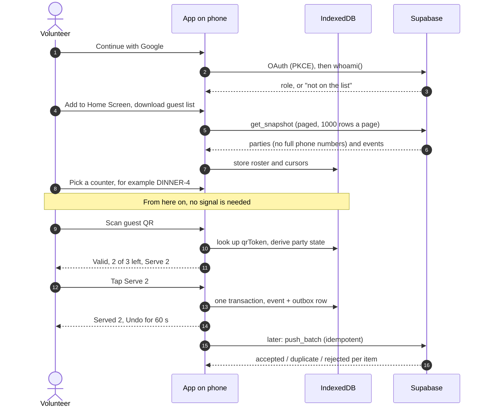
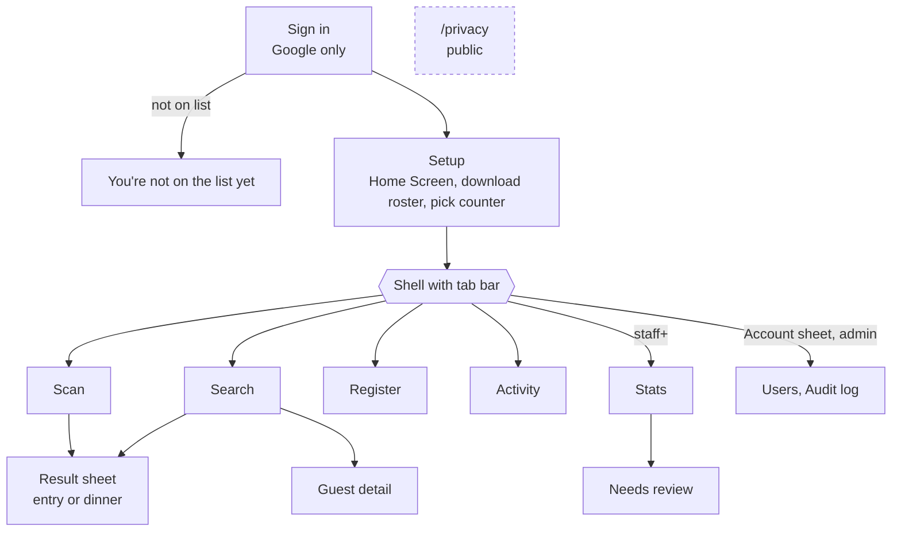
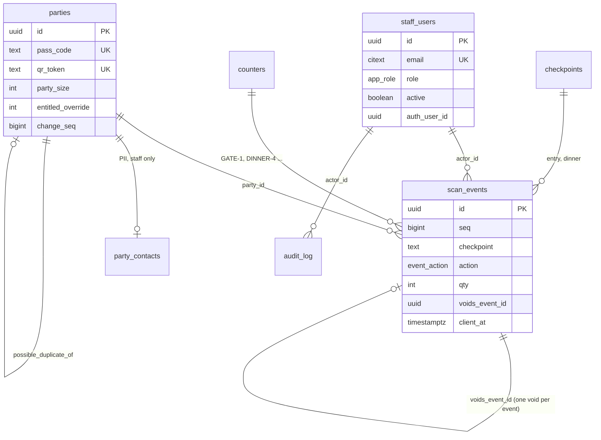
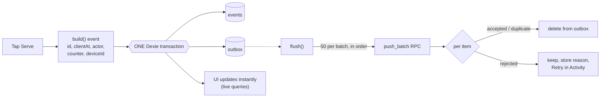
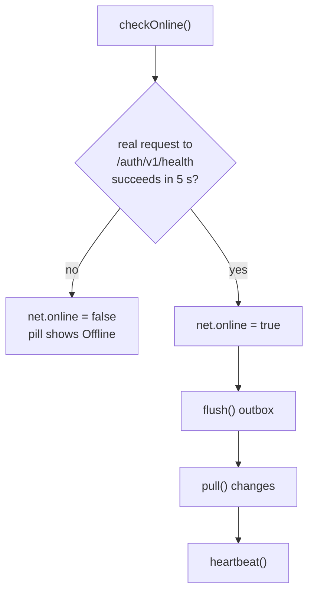
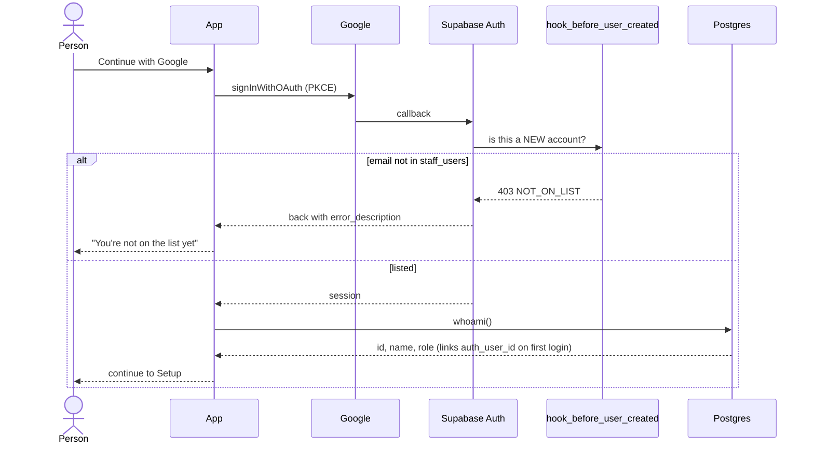

<div align="center">


# Homecoming 2026 Check-in

**A mobile-first, offline-first PWA for gate entry and dinner service at the GITAM Homecoming 2026 alumni event.**


Volunteers scan a guest's QR pass at the gate and at dinner counters, register walk-ins, and see their own activity.<br>
Staff see live totals, a needs-review queue, and can correct records. Admins decide who can sign in.<br>
It keeps working when the venue signal drops, and every change reaches the database exactly once when the phone is back online.

[Why](#why-this-exists) · [At a glance](#at-a-glance) · [Using it](#using-it) · [How it works](#how-it-works) · [Interesting engineering](#interesting-engineering) · [Security](#security-and-privacy) · [Code tour](#code-tour) · [Run it](#run-it-locally) · [Deploy](#deploy) · [Database](#the-database) · [Limits](#known-limits)

> [!NOTE]
> **Status:** built for one event (12 Dec 2026, Visakhapatnam). Primary devices are an iPhone 16 and a OnePlus 11. Project history, decisions and the to-do list are in [`CONTEXT.md`](CONTEXT.md).

</div>

---

## Why this exists

A few hundred alumni, their spouses and children arrive at one gate, then eat at one of ten dinner counters. Three things go wrong with a paper list or a shared spreadsheet:

1. **Signal.** Campus Wi-Fi and mobile data degrade exactly when everyone arrives. A tool that needs the network to scan is a tool that stops the queue.
2. **Double serving.** Two counters can serve the same party. A spreadsheet cannot tell which counter was first when both were offline.
3. **Accountability.** When a guest says "we were never served", someone has to be able to say who scanned what, where, and when, and nobody should be able to quietly edit that history.

That set the rules the project follows:

- **The phone is the source of truth while you are working.** Every scan is written to the phone first and the UI never waits on the network.
- **History is never edited.** Scans are facts. Undo is a new fact that cancels an old one.
- **The server is the referee.** It de-duplicates replays, enforces who may do what, and keeps the audit trail.
- **No servers to babysit.** Vercel serves static files; Supabase is the database and sign-in. Nothing else runs.

## At a glance



| Layer | Choice | Why |
| --- | --- | --- |
| UI | React 19, React Router 7, TypeScript | Screens are plain function components over a few tiny stores |
| Local data | Dexie (IndexedDB) | Survives reloads and offline stretches; transactions make "scan plus queue" atomic |
| Sync | Hand-written outbox, cursor pulls | Small, readable, and the server enforces correctness |
| Backend | Supabase Postgres, Auth, RPCs | No server code to host; rules live next to the data |
| Camera | `qr-scanner` | Decodes in a web worker; targets iPhone Safari and Android Chrome |
| Passes | `qrcode` | Draws the on-spot pass as SVG, offline |
| PWA | `vite-plugin-pwa` (Workbox) | Installable, precached, update on tap |
| Hosting | Vercel | Static build plus one rewrite rule |
| Lint and types | `oxlint`, `tsc -b` | Fast feedback; both run in CI |

## Features

| | |
| --- | --- |
| **Scan** | Live camera, torch, debounce against double decodes, vibration patterns for ok / warn / blocked, "enter code instead" fallback |
| **Entry** | Check in a whole party, or fewer people with a stepper (headcount). A "Maybe" spouse can be waved through or left out |
| **Dinner** | Serve 1..n of the remaining meals. Shows "Already served", "Check in first", and a heads-up for flagged parties |
| **Search** | Name or pass code, filter by batch year, "not checked in", "not served". Same result sheet as a scan |
| **Register** | On-spot guest with instant QR pass (works offline), duplicate warning, auto check-in |
| **Activity** | Everything this phone did, grouped into "Waiting to sync" and synced, with Undo while the window is open |
| **Stats** (staff) | Served, checked in, still to serve, needs review, per-counter totals with active/quiet chips |
| **Needs review** (staff) | Over-served parties, served without entry, possible duplicates; correct with a mandatory reason |
| **Users and roles** (admin) | Add people by email, set role, switch off. The last active admin cannot be removed |
| **Offline** | First run downloads the guest list. After that scans, search, register and undo all work with no signal |
| **Demo mode** | No keys needed. 480 fake parties, demo sign-in chips and a "simulate a scan" panel for local development |

### Roles

Three roles, ordered `volunteer < staff < admin` (the same order in TypeScript's `hasRole` and Postgres' `app_role` enum).

| Can do | Volunteer | Staff | Admin |
| --- | :---: | :---: | :---: |
| Scan, search, register, see own activity | ✅ | ✅ | ✅ |
| Undo | own scans, first 60 s | any scan, any time | any scan, any time |
| Stats and Needs review | | ✅ | ✅ |
| Correct a record (reset entry or dinner, reason required) | | ✅ | ✅ |
| Read a guest's full mobile and email (audited server function, not in the UI yet) | | ✅ | ✅ |
| Manage who can sign in, read the audit log | | | ✅ |

## Using it

### A volunteer's day



### Screens



The gate is decided by **which counter the volunteer picked**. A `GATE-*` counter starts the scanner in **Entry** mode; a `DINNER-*` counter starts it in **Dinner** mode. The counter is stamped on every scan, so staff can trace any serving to a desk.

### What a scan can show

`ResultFlow.tsx` is one sheet for every outcome. It picks a state from the scanner mode plus the party's derived state:

| Mode | Party state | Sheet | Buzz |
| --- | --- | --- | --- |
| Entry | not entered | **Valid**, stepper for headcount, Check in | ok |
| Entry | already entered | **Already checked in**, when / where / by whom | ok |
| Dinner | not entered | **Check in first**, one tap to check in here | warn |
| Dinner | entered, meals left | **Valid**, stepper, Serve n | ok |
| Dinner | no meals left | **Already served**, last serving details | bad |
| Dinner | served more than entitled | **Heads-up**, flagged after sync, staff will sort it | warn |
| either | QR without the `GH26:` prefix | **Not a Homecoming pass** (payment or website codes land here) | warn |
| either | token not on this phone | **Pass not found**, search by name or register | none |

## How it works

### 1. Boot and gating

`src/main.tsx` runs a few things in a deliberate order, then `App.tsx` picks a screen from three facts in `prefs`:

```tsx
{pathname === '/privacy'
  ? <PrivacyScreen />                         // public, no sign-in
  : !p.session
  ? <SignInScreen />                          // nobody signed in
  : !p.rosterAt || !p.counter
  ? <SetupScreen />                           // no guest list yet, or no counter chosen
  : <Shell />}                                // tabs, routes by role
```

Boot order matters:

1. `signinReturn.ts` is imported **first**. It reads `error_description` from the address bar (the sign-up hook's `NOT_ON_LIST` refusal) before the Supabase client can clear it.
2. In live mode the Supabase client is built **before** the router renders. Coming back from Google the client trades `?code=` for a session; if the router had already redirected `/` to `/scan`, the code would be lost and sign-in would silently never finish.
3. A leftover demo session (ids that are not UUIDs) is dropped, because it can never sync.
4. The service worker registers once, at boot, so the app shell is cached before sign-in completes.
5. React renders **without** `StrictMode`: sheets own browser-history entries and must not mount twice.

### 2. The data model: an append-only event log

The core idea: **never store state, store what happened.**



| Table | Role |
| --- | --- |
| `parties` | The guest roster. `party_size` is a **generated column**: `1 + (spouse <> 'no') + children`. Every update bumps `change_seq` |
| `party_contacts` | Full mobile and email. The only place PII lives |
| `scan_events` | Append-only. A trigger rejects `UPDATE` and `DELETE`. The client-made UUID is the idempotency key |
| `staff_users` | The allowlist and roles. Linked to `auth.users` on first sign-in |
| `audit_log` | Filled by triggers and RPCs: row before and after, who, why |
| `counters`, `checkpoints`, `event_settings`, `device_status`, `review_resolutions`, `import_batches` | Supporting tables |

An **event** is either `pass` (an entry or a dinner serving, with a `qty`) or `void` (it points at the event it cancels and carries a reason). A unique index `one_void_per_event` means a scan can be cancelled once.

### 3. Derived state: one rule, written twice

Whether a party has entered, how many meals remain, and whether it needs review are **computed, never stored**. The rule lives in two places that must agree: the TypeScript function `partyState()` in [`src/lib/state.ts`](src/lib/state.ts) (what phones use offline) and the SQL view `party_state` (what the server and the tests use).

```ts
// src/lib/state.ts (shortened)
const voided = new Set<string>()
for (const e of events) if (e.action === 'void' && e.voidsEventId) voided.add(e.voidsEventId)
const live = events.filter((e) => e.action === 'pass' && !voided.has(e.id))

const entries = live.filter((e) => e.checkpoint === 'entry')
                    .sort((a, b) => a.clientAt - b.clientAt || (a.receivedAt ?? Infinity) - (b.receivedAt ?? Infinity))
const first   = entries[0]                                    // earliest entry wins
const served  = live.filter((e) => e.checkpoint === 'dinner')
                    .reduce((n, e) => n + e.qty, 0)           // servings add up across counters
const entitled = party.entitledOverride ?? party.partySize

const overServed         = served > entitled
const servedWithoutEntry = served > 0 && !first
const possibleDuplicate  = party.possibleDuplicateOf !== null
const needsReview        = overServed || servedWithoutEntry || possibleDuplicate
```

| Rule | Why |
| --- | --- |
| Live = `pass` events with no void pointing at them | Undo is just another event |
| Earliest entry wins (`client_at`, then `received_at`) | Two gates scanning the same pass offline settle the same way on every phone |
| Dinner servings **add** across counters | Two counters offline both serve; after sync the total exceeds the entitlement and the party is flagged, not lost |
| `remaining = max(0, entitled - served)` | The UI never shows a negative number |
| `needsReview` = over-served, served without entry, or possible duplicate | Exactly the cases a human has to look at |

> [!IMPORTANT]
> If you change either implementation, change the other and run the database checks. They are the guard against the two drifting apart.

### 4. The write path: offline-first by construction



- **Invariant: event and outbox row are written in one local transaction** (`commit()` in [`actions.ts`](src/lib/actions.ts)). Either both exist or neither does, so nothing can be scanned and then forgotten, and nothing can be queued without being visible.
- The UI reads Dexie through live queries, so a scan shows up immediately with or without a network.
- `nextStamp()` is strictly increasing, so outbox order equals write order even inside one millisecond. A new on-spot guest's `party` row is stamped before its first `event`, so the foreign key holds when they replay on the server.
- **Idempotency.** Every id is a client UUID. The server answers `duplicate` for an id it already has, so a flaky connection that retries a batch cannot create a second serving.
- **One bad item never blocks the rest.** `push_batch` wraps each item in its own `begin ... exception when others` block and returns a status per item.
- `flush()` stops when a whole batch is rejected, so a poison item cannot spin forever. `retryFailed()` clears the error flags.

### 5. The read path: cursors, not timestamps

Phones track two server positions: `partyCursor` (`parties.change_seq`) and `eventCursor` (`scan_events.seq`). `get_snapshot(p_party_after, p_event_after, p_limit)` returns rows after those positions, plus new cursors and a `more` flag, so the first download and every later catch-up are the same call.

`push_batch` and `update_party` take the same `pg_advisory_xact_lock(1)` first. That makes **sequence order equal commit order**; without it a slow transaction could commit with a lower `seq` than one that already committed, and a phone whose cursor had moved past it would skip that row forever (migration `…0004` fixed exactly this for `update_party`).

A pull is a `bulkPut` by primary key, so when your own event comes back from the server it simply **upgrades the local copy** with its `seq` and `receivedAt`.

### 6. The sync loop

`startSync()` in [`sync.ts`](src/lib/sync.ts) triggers a cycle on: app open, `online` / `offline`, tab becoming visible, every 15 seconds, and right after every action.



`navigator.onLine` is **not trusted**: a phone on captive Wi-Fi reports online while nothing gets through. Connectivity is a real request. The heartbeat (`device_heartbeat`) reports counter, pending count, app version and clock offset, so staff can spot a phone on an old build or with a stuck queue.

### 7. Sign-in and the allowlist



Supabase Auth only proves **who** someone is. **Whether they may use the app** is the `staff_users` table:

- `whoami()` matches the **verified** email to `staff_users`, links the auth user on first login, and returns the role. Unlisted gives `null`; deactivated gives `{active: false}`. Either way the app signs out locally.
- The sign-up hook stops strangers from even creating an account (otherwise every Google user who finished the dance would land in Supabase's user list).
- Every RPC re-identifies the caller from `auth.uid()`, never from anything the client sends.

**Session edge cases** (all in [`layout.tsx`](src/components/layout.tsx), [`supabase.ts`](src/backend/supabase.ts) and [`actions.ts`](src/lib/actions.ts)):

- **Expired session while offline.** A banner offers "Sign in with Google" or "Keep scanning offline". Nothing is wiped. A `TOKEN_REFRESHED` event clears a false alarm.
- **A different account on the same phone.** With nothing unsynced, the new person takes the phone over with a clean copy (`startOver`). With unsynced changes, only the original account may resume, so two people's queues never mix.
- **Sign-out** warns about unsynced items first. It leaves the app, then wipes IndexedDB in the background (`wipePending`, 4 s give-up, retried at next start) so a database locked by a second tab cannot freeze the UI.
- **Counter per account.** The last counter each account used is remembered on that phone (`gh26.counters`), kept outside `prefs` because sign-out resets prefs.

### 8. Undo and corrections

Undo never edits anything; it appends a **void**.

| Who | When | How |
| --- | --- | --- |
| Volunteer | Own scans, within 60 s (`UNDO_WINDOW_S`) | Toast or Activity row, reason required |
| Staff / admin | Any scan, any time | Same, or the Correct record sheet (resets entry, dinner, or both with a reason) |

Server-side `_push_event` re-checks everything: a void must point at a plain `pass` of the **same guest**, cannot repeat, and for volunteers must be their own scan within 120 s. The app uses 60 s on purpose, so a 60 s undo is always accepted. Volunteers also cannot send `method = 'staff'` or an override reason.

### 9. Identifiers

| | Format | Notes |
| --- | --- | --- |
| QR payload | `GH26:` + 128-bit random token (base64url) | No personal data in the code. Anything without the prefix is "Not a Homecoming pass" |
| Pass code | `GH26-` + 5 chars from `23456789ABCDEFGHJKMNPQRSTVWXYZ` | No 0/O/1/I/L, easy to read aloud; `gh26 7k4q` normalises to `GH26-7K4Q` |
| Record ids | v4 UUID | `crypto.randomUUID()`, or a byte-built v4 on insecure origins where it does not exist |

### 10. Sheets that behave on a phone

`layers.ts` gives every sheet and alert a history entry, so the Android back button or iOS swipe closes the top-most sheet instead of leaving the app. `leaveLayers(() => navigate(...))` unwinds all open sheets first when a sheet needs to navigate. Sheets, alerts and toasts render through a portal into `.app` so they sit above the tab bar.

### 11. PWA and updates

- `registerType: 'prompt'`: a new version never reloads a phone mid-scan. The "Update available" banner only shows when **nothing is waiting to sync** and installs on tap.
- Workbox precaches `js, css, html, png, woff2, webmanifest`, with `navigateFallback: '/index.html'`. Lazy screens (Stats, Register, Admin, Review, Guest) are separate chunks, still precached, so they work offline.
- `vercel.json` rewrites unknown paths to `index.html` and serves `sw.js` with `Cache-Control: no-cache` so updates reach phones.
- The version shown in Account is `package.json` version + short commit (`__APP_VERSION__`, set in `vite.config.ts`) and travels in each heartbeat.
- Inter is self-hosted so Android does not fall back to Roboto and nothing is fetched at runtime.

## Interesting engineering

| Problem | What the project does | Where |
| --- | --- | --- |
| **The queue must never wait for the network** | Event plus outbox row in one IndexedDB transaction; UI reads live queries over it | [`actions.ts`](src/lib/actions.ts), [`hooks.ts`](src/lib/hooks.ts) |
| **Two offline counters serve the same party** | Servings add; the SQL view and `partyState()` flag the overage for staff instead of picking a winner | [`state.ts`](src/lib/state.ts), [schema](supabase/migrations/20261122000001_schema.sql) |
| **Retries must not double-count** | Client UUIDs as idempotency keys; `duplicate` is a normal answer | [`rpc.sql`](supabase/migrations/20261122000003_rpc.sql) |
| **Cursor pulls can skip rows** | One advisory lock for every writer that stamps a sequence, so commit order is sequence order | [`…0004`](supabase/migrations/20261122000004_update_party_lock.sql) |
| **"Online" lies on captive Wi-Fi** | A real health request with a 5 s timeout decides the pill | [`supabase.ts`](src/backend/supabase.ts) |
| **Google redirect loses the sign-in code** | Create the client before the router; read the error before the client clears the URL | [`main.tsx`](src/main.tsx), [`signinReturn.ts`](src/lib/signinReturn.ts) |
| **A locked database froze sign-out** | Leave first, wipe in the background with a timeout and a retry flag | [`db.ts`](src/lib/db.ts) |
| **Shipping the demo roster by accident** | A production build fails without both Supabase variables | [`vite.config.ts`](vite.config.ts) |
| **Strangers filling the user list** | Sign-up hook refuses unlisted emails; the app maps the error to a friendly screen | [`…0006`](supabase/migrations/20261122000006_signup_hook.sql) |
| **A new function silently open to the signed-out role** | Explicit revokes, and a database check that fails if any function is executable by `anon` | [`…0005`](supabase/migrations/20261122000005_lock_down.sql), [`checks.sql`](supabase/test/checks.sql) |
| **Two implementations of one rule** | The SQL view is the spec; the checks run the app's rules against it | [`checks.sql`](supabase/test/checks.sql) |

## Security and privacy

**Layers, outermost first:**

1. **Sign-up hook** refuses accounts that are not on the allowlist.
2. **`whoami()`** maps the verified email to a role; unlisted or inactive people get nothing.
3. **Row-level security** on every table. There are **no** insert, update or delete policies at all; every write goes through a `SECURITY DEFINER` RPC with a fixed `search_path`.
4. **Function grants.** The signed-out role (`anon`) can execute nothing. Internal helpers (`_require_staff`, `_push_event`, …) are not callable by signed-in users either.
5. **Column grants.** `parties.notes` is not readable by anyone through the API.
6. **Append-only triggers** on `scan_events`; **audit triggers** on parties, staff, settings and contacts; a **last-admin guard**.

**What a phone holds:** the roster has only the **last 4 digits** of a mobile number, no email, no notes. Full mobile and email are readable only through `get_party_contact`, which requires staff and writes an audit row on every read. A snapshot is checked to contain no `+91` or `@`.

**Secrets:** the app uses only the Supabase **publishable (anon)** key. The service-role key is never used by the app and must never be committed. `.env.local`, `.env.*.local`, `*.csv` and `test-passes/` are gitignored.

The public [privacy policy](src/screens/Privacy.tsx) is served at `/privacy` without signing in (Google asks for it before publishing the consent screen).

## Code tour

```
.
├── index.html, vite.config.ts, vercel.json     entry, build + PWA config, SPA rewrite
├── src/
│   ├── main.tsx                                boot order (see "Boot and gating")
│   ├── App.tsx                                 session / setup / shell gating, role-based routes
│   ├── screens/                                one file per screen
│   │   ├── SignIn, Setup                       first run
│   │   ├── Scan, Search, Register, Activity    the four tabs
│   │   ├── Stats, Review, GuestDetail          staff tools
│   │   ├── Admin (Users, Audit)                admin tools
│   │   └── Privacy                             public page
│   ├── components/
│   │   ├── ui.tsx, sprite.ts                   design-system primitives, icon sprite
│   │   ├── ResultFlow.tsx                      the one sheet for every scan result
│   │   ├── UndoSheet, CorrectionSheet          void events, with reasons
│   │   ├── AccountSheet, layout.tsx            counter, sign-out, tab bar, banners
│   │   └── Qr, Wheel, ActionToast
│   ├── lib/                                    framework-free logic
│   │   ├── state.ts      partyState(): derived state (mirror of SQL view)
│   │   ├── actions.ts    every write: checkIn, serveDinner, voidEvent, registerOnSpot, startOver
│   │   ├── sync.ts       outbox flush, cursor pull, heartbeat, online check
│   │   ├── db.ts         Dexie schema, wipe
│   │   ├── store.ts      createStore(): tiny external store + localStorage
│   │   ├── prefs.ts, ui.ts, counter.ts, layers.ts, hooks.ts, ids.ts, format.ts, undo.ts, config.ts, types.ts
│   │   └── signinReturn.ts
│   ├── backend/
│   │   ├── types.ts      the Backend interface (the seam)
│   │   ├── supabase.ts   live implementation
│   │   ├── demoBackend.ts, demo.ts   built-in fake server and roster
│   │   └── index.ts      picks one
│   └── styles/           tokens.css (generated), gh.css (components), app.css (layout)
├── supabase/
│   ├── migrations/       six files, run in order
│   ├── seed_admin.sql, seed_dev.sql, setup_all.sql
│   └── test/             Docker harness + 58 acceptance checks
├── scripts/test_passes.py                      printable QR sheets for rehearsals
├── .github/workflows/ci.yml                    lint, typecheck, build, database checks
├── CONTEXT.md, MISSING_SCREENS.md              history, decisions, to-do
```

### The backend seam

Everything the UI needs from a server is one interface, [`src/backend/types.ts`](src/backend/types.ts). `supabase.ts` implements it for real; `demoBackend.ts` fakes it; `index.ts` picks one from `LIVE`. Screens never import Supabase.

| Method | Supabase implementation |
| --- | --- |
| `signInWithGoogle` / `resume` | `signInWithOAuth` (PKCE), then `rpc('whoami')`; `{ rejectedEmail }` when it returns null |
| `fetchSnapshot` / `fetchChanges` | paged `get_snapshot`, mapping snake_case rows to `Party` / `ScanEvent` |
| `pushBatch` | `push_batch`, mapped to `accepted` / `duplicate` / `rejected` per item |
| `heartbeat` | `device_heartbeat` |
| `ping` | `GET /auth/v1/health` with the anon key, 5 s timeout |
| `listUsers` / `saveUser` | `admin_list_users` / `admin_set_user` |

### Syntax and conventions

- **TypeScript:** ES2023 target, bundler resolution. Imports carry the real extension (`'./lib/state.ts'`, `allowImportingTsExtensions`). `verbatimModuleSyntax` means type-only imports are written `import type`. `erasableSyntaxOnly` rules out enums and parameter properties, so unions like `Role = 'volunteer' | 'staff' | 'admin'` are used instead. `noUnusedLocals` and `noUnusedParameters` are on.
- **Style:** no semicolons, single quotes, two-space indent. Comments explain *why* (an invariant or a bug that was fixed), not *what*.
- **State:** no state library. `createStore<T>()` is ~40 lines over `useSyncExternalStore`, optionally persisted to `localStorage` and kept in sync across tabs through the `storage` event. Four stores use it: `prefs` (session, counter, theme, cursors), `net` (online, syncing), `ui` (account sheet, last action, update flag) and the per-account counter map in `counter.ts`.
- **Data in components:** `useLiveQuery` from `dexie-react-hooks` re-runs when IndexedDB changes. `useRoster()` loads about 500 parties and 1,000 events and derives every party's state in one pass.
- **Naming:** domain types in `lib/types.ts` are camelCase (`qrToken`, `clientAt`); `backend/supabase.ts` converts from the database's snake_case in `toParty` / `toEvent`.
- **SQL:** every RPC is `SECURITY DEFINER` with `set search_path = public`; helpers start with an underscore and are not granted to anyone; new functions end with `revoke execute ... from public, anon` and an explicit grant, because Postgres makes new functions executable by everyone by default.

## Run it locally

Needs Node 22 or newer.

```sh
npm install
npm run dev          # http://localhost:5173
npm run dev:phone    # HTTPS on your LAN so a real phone can use the camera
npm run typecheck    # tsc -b
npm run lint         # oxlint
npm run build        # tsc -b && vite build, static files in dist/
```

### Two modes

| | Live | Demo |
| --- | --- | --- |
| When | `VITE_SUPABASE_URL` and `VITE_SUPABASE_ANON_KEY` are set | No keys, or `VITE_DEMO=true` |
| Data | Your Supabase project | 480 built-in fake parties |
| Sign-in | Google | Chips: Volunteer, Staff, Admin, Not on the list |
| Extras | none | "Simulate a scan" panel, demo tools in Account |
| Production build | allowed | **fails** unless `VITE_DEMO=true` |

Copy `.env.example` to `.env.local` and fill in the two values (Supabase, Project Settings, API). The camera needs a secure origin: `localhost` or HTTPS. On a plain `http://<lan-ip>` browsers expose no camera, and the app says so.

**Android over adb:** `adb -s <ip:port> reverse tcp:5173 tcp:5173`, then open `http://localhost:5173` in Chrome. Pin `-s`, because the phone can show up twice.

## Deploy

1. Push to GitHub (private recommended).
2. Vercel: **Add New, Project**, import the repo. Preset **Vite**, build `npm run build`, output `dist`.
3. **Environment Variables** (Production and Preview): `VITE_SUPABASE_URL` and `VITE_SUPABASE_ANON_KEY` (the publishable key, never the service-role key). They are baked in at build time, so redeploy after changing them.
4. Allow the production URL:
   - **Google Cloud**, your OAuth client: add it to **Authorized JavaScript origins**. The redirect URI (Supabase's `/auth/v1/callback`) does not change.
   - **Supabase**, Authentication, URL Configuration: set **Site URL** to the production address and add `https://<app>.vercel.app/**` to **Redirect URLs**.
5. Test on the production domain. Preview deployments get random URLs that are not in the Redirect URLs.
6. Before real volunteers sign in, publish the Google consent screen (Audience, **Publish app**, Testing to In production). Until then only listed test users can sign in.

### Event timeline

| Date | Milestone |
| --- | --- |
| 8 Dec | Feature freeze |
| 9 Dec | Version freeze, full rehearsal (about 10 phones: 2 gate and 10 dinner roles, offline flapping) |
| 10 Dec | Code freeze, final import |
| 11 Dec | Every phone installed, signed in online, roster downloaded |
| 12 Dec | Set `event_settings.is_live = true` in the morning |

## The database

Six migrations in [`supabase/migrations/`](supabase/migrations), run in filename order. [`setup_all.sql`](supabase/setup_all.sql) is all of them plus fake seed data for a brand-new project.

| Migration | What it adds |
| --- | --- |
| `…01_schema` | Tables, enums, sequences, the append-only log, the `party_state` view |
| `…02_security` | Role helpers, audit triggers, last-admin guard, RLS, grants |
| `…03_rpc` | `whoami`, `get_snapshot`, `push_batch`, `device_heartbeat`, staff and admin RPCs |
| `…04_update_party_lock` | `update_party` takes the same advisory lock as `push_batch` |
| `…05_lock_down` | No function open to `anon`; contacts and notes only via audited paths; stricter voids |
| `…06_signup_hook` | `hook_before_user_created`. **Also switch it on** in Authentication, Hooks, Before User Created |

**RPCs:** `whoami`, `get_snapshot`, `push_batch`, `device_heartbeat`, `get_party_contact`, `resolve_review`, `update_party`, `admin_set_user`, `admin_list_users`, `audit_feed`. The app calls the first four plus the two admin user RPCs today; the rest exist on the server for features still to be wired (see [Known limits](#known-limits)).

### Acceptance tests

```sh
supabase/test/harness.sh     # needs Docker
```

It starts a throwaway `postgres:16`, loads a stand-in for Supabase's `auth` schema, applies every migration and the dev seed, then runs [`checks.sql`](supabase/test/checks.sql) **as real roles** (`anon`, `authenticated`) with a simulated `auth.uid()`. The last line reads `ALL CHECKS PASSED`. They cover:

- unlisted and inactive accounts get nothing; volunteers cannot reach staff or admin data
- replaying a batch creates no duplicates; two devices' servings add; over-serving and served-without-entry are flagged
- undo rules: own scans only, 120 s server window, no double undo, a void must hit the same guest's plain scan
- on-spot registration: mobile normalised to `+91`, same mobile flags a possible duplicate, roster keeps only the last four digits
- contacts and notes cannot be read directly; contact reads are audited; edits are audited with their reason
- last-admin guard; `scan_events` cannot be updated or deleted; no function executable by `anon`; the sign-up hook

CI runs lint, typecheck, build (with placeholder variables, nothing talks to a real project) and these database checks on every push to `main` and every pull request. **Run them before changing sync, derived state or RLS.**

### Rehearsal passes

`scripts/test_passes.py` (needs `pip install reportlab`) turns an exported CSV of fake guests into printable QR sheets, four per page, plus a sheet of codes that **must** be rejected: unknown `GH26:` tokens, a URL, a UPI payment code, plain text, and a `GH25:` prefix. The sheets carry live tokens for the hosted database, so `test-passes/` and `*.csv` are gitignored.

## Known limits

> [!NOTE]
> - **Realtime is not built.** Phones pull every 15 s, so another counter's serving can take up to that long to appear. The server's flag-after-sync rule is what catches the race.
> - **Counters are hard-coded** in `src/lib/config.ts` next to the `counters` table. A management screen would make the table the single source ([`MISSING_SCREENS.md`](MISSING_SCREENS.md)).
> - **The audit screen is local.** It lists undos and corrections synced to the phone. The server's `audit_feed` is not wired in yet; neither are `get_party_contact` (guest screen), `resolve_review` or `update_party`.
> - **Stats and Needs review are derived on the phone** from the roster and events; the server-side stats RPCs are not built.
> - **Pending changes detail screen** (per-item state and Retry) is not built; the Activity tab shows a "Waiting to sync" group.
> - **Undo timing trusts the phone's clock** for volunteers, because undo has to work offline.
> - **Dexie schema is at version 1.** Changing stored fields needs `this.version(2)` with an upgrade or phones keep an incompatible copy.
> - **Not yet verified on real hardware:** camera scans of real passes against live data, Add to Home Screen and Google sign-in inside an installed iPhone PWA, two phones offline for a long stretch, and GITAM Workspace accounts if an admin policy blocks third-party OAuth apps.

## Documentation map

| File | Read it for |
| --- | --- |
| [`CONTEXT.md`](CONTEXT.md) | Decisions, bugs found and fixed, what is verified, cleanup SQL, the event timeline |
| [`supabase/README.md`](supabase/README.md) | Setting up a hosted project, the sign-up hook, resetting test data |
| [`MISSING_SCREENS.md`](MISSING_SCREENS.md) | Screens still to build |
| [`supabase/test/checks.sql`](supabase/test/checks.sql) | The executable specification of the database rules |

Looks come from the GITAM Homecoming design system: `src/styles/tokens.css` is generated from its tokens, and `gh.css` is its component stylesheet.
