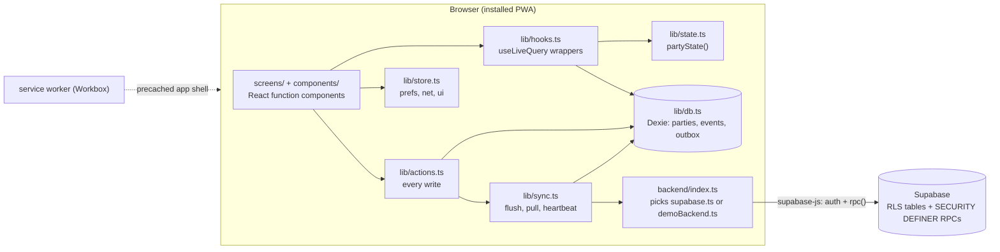
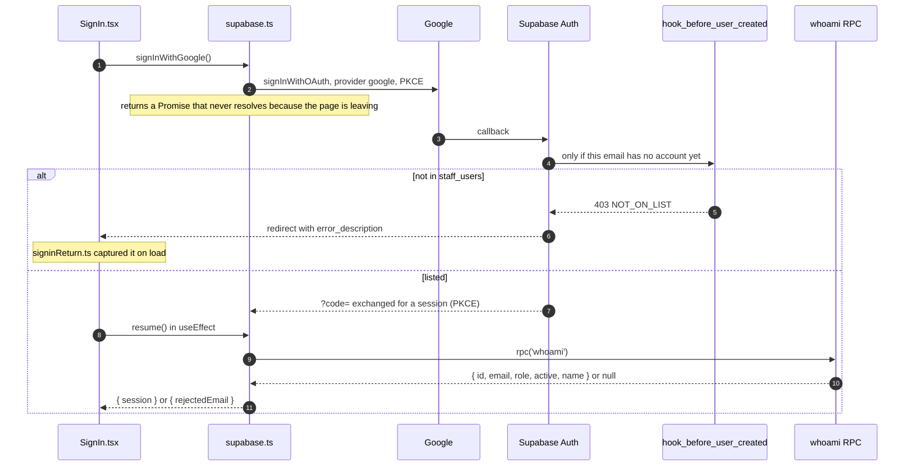
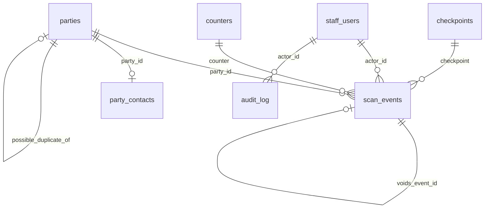

<div align="center">

# Homecoming 2026 Check-in: code walkthrough

An offline-first React PWA backed by Supabase (Postgres, Auth and RPCs).<br>
This document explains **how the code works**: architecture, data model, every module in `src/`, the SQL, the build, and the conventions used.


[Architecture](#1-architecture) · [Repo map](#2-repo-map) · [Boot](#3-boot-and-routing) · [Types](#4-core-types) · [Stores](#5-stores-prefs-net-ui) · [Local DB](#6-local-database-dexie) · [Derived state](#7-derived-state) · [Writes](#8-writes-actionsts) · [Sync](#9-sync-syncts) · [Backend seam](#10-the-backend-seam) · [Auth](#11-auth-flow) · [Helpers](#12-small-modules) · [UI](#13-ui-layer) · [Screens](#14-screens) · [Build](#15-build-pwa-and-hosting) · [SQL](#16-the-database) · [Tests and CI](#17-tests-scripts-and-ci) · [Conventions](#18-conventions-and-syntax) · [Run](#19-run-and-deploy)

</div>

---

## 1. Architecture

Everything runs in the browser. There is no application server: Vercel serves static files, Supabase is the database and the sign-in provider.



Three rules drive the whole design, and most of the code is a consequence of them:

1. **Local first.** A write goes to IndexedDB and an outbox in one transaction. The UI reads IndexedDB through live queries. The network is never on the critical path.
2. **Append-only facts.** The unit of data is an immutable *event*. Current state is **derived** from events, never stored. Undo is a new event that points at the old one.
3. **The server is the referee.** It de-duplicates replays by client UUID, enforces roles and the undo rules, and writes the audit trail. The client's checks are for UX; the server's are the real ones.

## 2. Repo map

```
.
├── index.html                 PWA meta tags, mounts #root, loads src/main.tsx
├── vite.config.ts             __APP_VERSION__, production-key guard, PWA manifest + Workbox
├── vercel.json                SPA rewrite, no-cache for sw.js
├── tsconfig*.json             bundler mode, erasableSyntaxOnly, verbatimModuleSyntax
├── .oxlintrc.json             react/rules-of-hooks error, only-export-components warn
├── src/
│   ├── main.tsx               boot order
│   ├── App.tsx                gating (sign-in / setup / shell) and role-based routes
│   ├── vite-env.d.ts          typed env vars, __APP_VERSION__
│   ├── lib/                   logic with no JSX
│   │   ├── types.ts           Party, ScanEvent, OutboxItem, Session, hasRole
│   │   ├── state.ts           partyState(), liveEvents(), groupByParty()
│   │   ├── actions.ts         checkIn, serveDinner, voidEvent, resetCheckpoints, registerOnSpot ...
│   │   ├── sync.ts            flush(), pull(), heartbeat(), checkOnline(), startSync()
│   │   ├── db.ts              Dexie schema, clearLocalData(), finishWipe()
│   │   ├── store.ts           createStore(): external store + localStorage
│   │   ├── prefs.ts           persisted preferences and session
│   │   ├── ui.ts              cross-screen UI state
│   │   ├── hooks.ts           useRoster, usePartyView, useSyncStatus, usePendingIds, useNow
│   │   ├── ids.ts             UUIDs, QR tokens, pass codes, QR parsing
│   │   ├── counter.ts         per-account remembered counter
│   │   ├── layers.ts          history-backed sheets
│   │   ├── undo.ts            undoStatus(), undoSecondsLeft()
│   │   ├── format.ts          time, names, phone digits, vibration
│   │   ├── config.ts          LIVE/DEMO, constants, COUNTERS, SCHOOLS
│   │   ├── signinReturn.ts    reads the sign-in refusal from the URL
│   │   └── guestImport.ts     CSV parsing, row checking, template and pass-list CSV
│   ├── backend/
│   │   ├── types.ts           the Backend interface
│   │   ├── supabase.ts        implementation over supabase-js
│   │   ├── demoBackend.ts     in-browser fake
│   │   ├── demo.ts            deterministic fake roster and events
│   │   └── index.ts           picks one
│   ├── components/            ui.tsx primitives, ResultFlow, UndoSheet, CorrectionSheet,
│   │                          AccountSheet, layout (TopRow, Banners, TabBar), Qr, Wheel, ActionToast, sprite
│   ├── screens/               SignIn, Setup, Scan, Search, Register, Activity, Stats, Review,
│   │                          GuestDetail, Admin (Users, Audit), Import, Privacy
│   └── styles/                tokens.css (generated), gh.css (components), app.css (layout)
├── supabase/
│   ├── migrations/            7 files, run in order
│   ├── setup_all.sql          all migrations + fake data for a new project
│   ├── seed_admin.sql, seed_dev.sql
│   └── test/                  harness.sh, stub_auth.sql, checks.sql
├── public/guest-list-guide.pdf  printable guide for the import template
├── scripts/test_passes.py     printable QR sheets (ReportLab)
├── scripts/make_guest_guide.py  generates the PDF guide
└── .github/workflows/ci.yml   lint, typecheck, build, database checks
```

## 3. Boot and routing

### 3.1 [`src/main.tsx`](src/main.tsx)

Order matters here; each step exists because skipping it broke something.

```ts
import './lib/signinReturn.ts'          // 1. first import: reads the URL before supabase-js can clear it

applyAppearance()                        // 2. theme + big-text class on <html>
prefs.subscribe(applyAppearance)
matchMedia('(prefers-color-scheme: dark)').addEventListener('change', applyAppearance)

if (LIVE) {
  sb()                                   // 3. build the Supabase client BEFORE the router renders
  const s = prefs.get().session          //    drop a leftover demo session (ids that are not UUIDs)
  if (s && !UUID.test(s.actorId)) void startOver(null)
}

const updateSW = registerSW({ onNeedRefresh: () => ui.set({ needRefresh: true }) })   // 4.
ui.set({ updateSW })

createRoot(document.getElementById('root')!).render(<BrowserRouter><App /></BrowserRouter>)  // 5. no StrictMode
```

1. `signinReturn.ts` runs its module body (`capture()`) on import. If Google came back with `error_description`, it records the reason and cleans the address with `history.replaceState`.
2. `applyAppearance()` reads `prefs` and the OS colour scheme, so the first paint already has the right theme.
3. The Supabase client is created lazily (`sb()`), so demo mode never builds one (supabase-js throws on an empty URL). In live mode it is forced to exist before routing: with `detectSessionInUrl: true` and `flowType: 'pkce'`, the client exchanges `?code=` for a session on construction. If the router had already redirected `/` to `/scan`, the code would be gone.
4. `registerSW` is called once; `registerType: 'prompt'` means a new worker waits instead of reloading the page. The callback only sets a flag; the banner decides when to show it.
5. No `React.StrictMode`: sheets push history entries in an effect (see [`layers.ts`](#124-layersts)), and StrictMode's double mount would push twice.

### 3.2 [`src/App.tsx`](src/App.tsx)

```tsx
export default function App() {
  const p = prefs.use()
  const { pathname } = useLocation()
  useEffect(() => startSync(), [])
  return (
    <div className="gh app">
      <Sprite />
      {pathname === '/privacy' ? <PrivacyScreen />
        : !p.session ? <SignInScreen />
        : !p.rosterAt || !p.counter ? <SetupScreen />
        : <Shell />}
    </div>
  )
}
```

The screen is a pure function of three persisted facts: **session**, **rosterAt** (set when the first download completes) and **counter**. There is no "current step" state to get out of sync. `startSync()` is idempotent and starts the sync loop once for the whole app.

`Shell` builds the route table from the role:

```tsx
const staff = hasRole(role, 'staff'); const admin = hasRole(role, 'admin')
<Routes>
  <Route path="/scan" .../> <Route path="/search" .../> <Route path="/register" .../>
  <Route path="/activity" .../> <Route path="/guest/:id" .../>
  {staff && <Route path="/stats" .../>}  {staff && <Route path="/stats/review" .../>}
  {admin && <Route path="/admin/users" .../>}  {admin && <Route path="/admin/audit" .../>}  {admin && <Route path="/admin/import" .../>}
  <Route path="*" element={<Navigate to="/scan" replace />} />
</Routes>
```

A route that is not registered for the role falls through to `*` and redirects to `/scan`. This is a UI convenience; the data is protected by the database (section 16). The less-used screens (`Audit`, `Users`, `Import`, `GuestDetail`, `Register`, `Review`, `Stats`) are `lazy()` imports, which Vite splits into chunks; Workbox precaches every chunk, so they still load offline.

## 4. Core types

[`src/lib/types.ts`](src/lib/types.ts) is the vocabulary shared by every layer.

```ts
export type Role = 'volunteer' | 'staff' | 'admin'
export type Checkpoint = 'entry' | 'dinner'
export type Method = 'qr' | 'search' | 'code' | 'staff'

export interface Party {             // one roster row; held on every phone
  id: string; passCode: string; qrToken: string; source: 'booked' | 'onspot'
  leadName: string; nameLc: string   // nameLc = lowercase copy, indexed for search
  batchYear: number; school: string | null; department: string | null; course: string | null
  mobileLast4: string                // never the full number
  spouse: 'no' | 'yes' | 'maybe'; children: number; partySize: number
  entitledOverride: number | null; parking: 'none' | 'two_wheeler' | 'four_wheeler'
  possibleDuplicateOf: string | null; deletedAt: string | null
}

export interface ScanEvent {         // append-only
  id: string; seq?: number           // seq is server order; absent until the server has it
  partyId: string; checkpoint: Checkpoint; action: 'pass' | 'void'
  qty: number                        // entry: headcount, dinner: servings
  voidsEventId?: string | null; reason?: string | null; overrideReason?: string | null
  method: Method; actorId: string; actorName: string; counter: string; deviceId: string
  clientAt: number; receivedAt?: number    // epoch ms
}

export interface OutboxItem { id: string; type: 'party' | 'event'; payload: unknown
                              attempts: number; createdAt: number; lastError?: string | null }

export type PushResult = { id: string; status: 'accepted' | 'duplicate' }
                       | { id: string; status: 'rejected'; reason: string }

const roleRank: Record<Role, number> = { volunteer: 0, staff: 1, admin: 2 }
export const hasRole = (s: Session | null, min: Role) => !!s && roleRank[s.role] >= roleRank[min]
```

- `ScanEvent.action` is a discriminator: `'pass'` is a real-world fact; `'void'` cancels the event named by `voidsEventId` and must carry a `reason`.
- `seq` and `receivedAt` are optional because a phone creates an event before the server has seen it. The server fills them in; a later pull overwrites the local copy by id.
- `PushResult` is a discriminated union on `status`, so `reason` only exists on `'rejected'`.
- `hasRole` compares ranks, mirroring the `app_role` enum order in Postgres (`volunteer < staff < admin`).

## 5. Stores: prefs, net, ui

No state library. [`src/lib/store.ts`](src/lib/store.ts) is the whole thing:

```ts
export function createStore<T extends object>(init: T, key?: string) {
  let state: T = init
  if (key) { /* merge JSON from localStorage over init (try/catch for corrupt data) */ }
  const subs = new Set<() => void>()
  const get = () => state
  const subscribe = (f: () => void) => { subs.add(f); return () => { subs.delete(f) } }
  const set = (patch: Partial<T>) => {
    state = { ...state, ...patch }                     // new object every time: React sees a change
    if (key) localStorage.setItem(key, JSON.stringify(state))
    subs.forEach((f) => f())
  }
  if (key) addEventListener('storage', (e) => {        // another tab wrote: adopt it, don't overwrite it
    if (e.key !== key || e.newValue == null) return
    state = { ...init, ...JSON.parse(e.newValue) }; subs.forEach((f) => f())
  })
  const use = () => useSyncExternalStore(subscribe, get)
  return { get, set, subscribe, use }
}
```

- `use()` is React's `useSyncExternalStore`, so components re-render on `set` without context providers. `get()` is usable outside React (in `actions.ts`, `sync.ts`).
- `set` replaces `state` with a **new object**; `useSyncExternalStore` compares snapshots by identity, so mutation would not re-render.
- The `storage` event fires in *other* tabs only, which makes sign-out, counter and theme follow across tabs.

Four stores use it:

| Store | Key | Holds |
| --- | --- | --- |
| `prefs` ([`prefs.ts`](src/lib/prefs.ts)) | `gh26.prefs` | `deviceId`, `counter`, `mode`, `theme`, `bigText`, `session`, `sessionExpired`, `rosterAt`, `lastSyncAt`, `homeScreenDone`, `cameraAsked`, `demoOffline`, `wipePending`, `partyCursor`, `eventCursor` |
| `net` ([`sync.ts`](src/lib/sync.ts)) | none (memory) | `online`, `syncing` |
| `ui` ([`ui.ts`](src/lib/ui.ts)) | none | `account` (sheet open), `last` (last action for the undo toast), `needRefresh`, `updateSW` |
| counters ([`counter.ts`](src/lib/counter.ts)) | `gh26.counters` | `byAccount: { [actorId]: counterCode }` |

`prefs` generates a `deviceId` default with `newId()` and re-checks it right after creation: if the stored value is not a UUID (an older build) it is replaced, because the database column is `uuid`. `applyAppearance()` sets `data-theme` on `<html>` (`dark` if the theme is dark, or auto and the OS prefers dark) and toggles the `xl` class for larger text.

The counter map is **separate** from `prefs` because sign-out resets `prefs` and the point of the map is to survive that.

## 6. Local database (Dexie)

[`src/lib/db.ts`](src/lib/db.ts):

```ts
class AppDB extends Dexie {
  parties!: Table<Party, string>; events!: Table<ScanEvent, string>; outbox!: Table<OutboxItem, string>
  constructor() {
    super('gh26')
    this.version(1).stores({
      parties: 'id, &qrToken, &passCode, nameLc, batchYear, [nameLc+batchYear]',
      events:  'id, partyId, seq, clientAt',
      outbox:  'id, createdAt',
    })
  }
}
```

The strings are Dexie **index specs**: the first name is the primary key; `&` means unique; `[a+b]` is a compound index. So a QR scan is an indexed lookup (`where('qrToken').equals(token)`), a typed pass code is another (`passCode`), and `events.where('partyId')` gets one party's history without a scan. Only indexed fields are listed; other fields are stored but not queryable. **The schema is at version 1**: changing stored fields requires `this.version(2)` with an upgrade function.

`clearLocalData()` empties all three tables in one transaction. `finishWipe()` is the sign-out wipe:

```ts
export function finishWipe(): Promise<boolean> {
  if (!prefs.get().wipePending) return Promise.resolve(true)
  wiping ??= Promise.race([
    clearLocalData().then(() => { prefs.set({ wipePending: false }); return true }),
    new Promise<boolean>((r) => setTimeout(() => r(false), 4000)),   // give up after 4 s
  ]).catch(() => false).finally(() => { wiping = null })
  return wiping
}
```

It never throws and always resolves within 4 s. The module-level `wiping` promise de-duplicates concurrent callers (`??=`). If the database is locked (a second tab holds a connection), it resolves `false`, `wipePending` stays set, and the next start retries. `flush()`, `pull()` and `heartbeat()` all refuse to run while `wipePending` is true so nothing is written after the wipe.

## 7. Derived state

[`src/lib/state.ts`](src/lib/state.ts) turns a party plus its events into everything the UI needs:

```ts
export function partyState(party: Party, events: ScanEvent[]): PartyState {
  const voided = new Set<string>()
  for (const e of events) if (e.action === 'void' && e.voidsEventId) voided.add(e.voidsEventId)
  const live = events.filter((e) => e.action === 'pass' && !voided.has(e.id))

  const entries = live.filter((e) => e.checkpoint === 'entry')
    .sort((a, b) => a.clientAt - b.clientAt || (a.receivedAt ?? Infinity) - (b.receivedAt ?? Infinity))
  const first = entries[0]
  const dinners = live.filter((e) => e.checkpoint === 'dinner')
  const served = dinners.reduce((n, e) => n + e.qty, 0)
  const entitled = party.entitledOverride ?? party.partySize

  const entered = !!first
  const overServed = served > entitled
  const servedWithoutEntry = served > 0 && !entered
  const possibleDuplicate = party.possibleDuplicateOf !== null
  return { partyId: party.id, entitled, entered, enteredAt: first?.clientAt ?? null,
    headcount: first?.qty ?? null, enteredCounter: first?.counter ?? null, enteredBy: first?.actorName ?? null,
    served, remaining: Math.max(0, entitled - served),
    lastServedAt: dinners.length ? Math.max(...dinners.map((e) => e.clientAt)) : null,
    overServed, servedWithoutEntry, duplicateEntry: entries.length > 1, possibleDuplicate,
    needsReview: overServed || servedWithoutEntry || possibleDuplicate }
}
```

Line by line:

- **Voids.** First pass collects every id that some void points at. A void is never "live" itself (`action === 'pass'` filter), so voiding a void has no effect; the server rejects it anyway.
- **Entry.** Several entry events can exist (two gates, offline). Sort by `clientAt`, ties broken by `receivedAt`, with `?? Infinity` so an unsynced event (no `receivedAt`) sorts after a synced one at the same instant. The earliest wins; `duplicateEntry` records that there were more.
- **Dinner.** Servings are **summed** (`qty` is "how many meals"). That is what lets two offline counters both serve and have the total exceed `entitled` afterwards.
- **`needsReview`** is exactly the three conditions a human must look at. `duplicateEntry` is computed but is not part of it.
- `liveEvents(events)` exposes the same void filter for code that only needs the live list (Stats, Review, CorrectionSheet). `groupByParty` buckets events once so `useRoster` is O(parties + events).

This logic exists **twice**. The SQL view `party_state` ([schema migration](supabase/migrations/20261122000001_schema.sql)) has the same rules written with a `distinct on (party_id) ... order by party_id, client_at, received_at` for "earliest entry" and `sum(qty)` for servings. The database acceptance checks assert the flags the view produces for scripted scenarios. If you change one, change the other.

### 7.1 [`src/lib/hooks.ts`](src/lib/hooks.ts): reading state in components

```ts
export function useRoster(): Roster | undefined {
  return useLiveQuery(async () => {
    const [parties, events] = await Promise.all([db.parties.toArray(), db.events.toArray()])
    const grouped = groupByParty(events)
    const states = new Map<string, PartyState>(); const byId = new Map<string, Party>()
    for (const p of parties) { byId.set(p.id, p); states.set(p.id, partyState(p, grouped.get(p.id) ?? [])) }
    return { parties: parties.filter((p) => !p.deletedAt), events, byId, states }
  }, [])
}
```

`useLiveQuery` (dexie-react-hooks) re-runs the async function whenever any table it read changes, and returns `undefined` until the first result. About 500 parties and 1,000 events are derived on every local change; that is cheap enough that nothing is cached. Soft-deleted parties are dropped from `parties` but stay in `byId`/`states` so an old event can still resolve a name.

Other hooks: `usePartyView(id)` (one party, its events, its state; `null` when not found, `undefined` while loading, a distinction `ResultFlow` depends on), `useSyncStatus()` (`net` store plus outbox counts for pending and failed), `usePendingIds()` (a `Set` of event ids still in the outbox, used to split "Waiting to sync" from "Synced"), `useNow(ms)` (a ticking timestamp for countdowns).

## 8. Writes: actions.ts

Every mutation is in [`src/lib/actions.ts`](src/lib/actions.ts). Components never touch `db` for writing.

### 8.1 Building and committing an event

```ts
function ctx() {
  const p = prefs.get()
  if (!p.session || !p.counter) throw new Error('This phone is not set up yet')
  return { actorId: p.session.actorId, actorName: shortName(p.session.name), counter: p.counter, deviceId: p.deviceId }
}
const build = (e: NewEvent): ScanEvent => ({ id: newId(), clientAt: Date.now(), ...ctx(), ...e })

async function commit(events: ScanEvent[], party?: { party: Party; contact: PartyContact }) {
  await db.transaction('rw', db.parties, db.events, db.outbox, async () => {
    if (party) {
      await db.parties.add(party.party)
      await db.outbox.add({ id: party.party.id, type: 'party', payload: party, attempts: 0, createdAt: nextStamp() })
    }
    await db.events.bulkAdd(events)
    await db.outbox.bulkAdd(events.map((e) => ({ id: e.id, type: 'event' as const, payload: e, attempts: 0, createdAt: nextStamp() })))
  })
  if (net.get().online) kickSync()
  return events
}
```

- `build` stamps identity (`ctx`) and a fresh UUID and time; the caller's fields (`...e`) are spread last so they win.
- `commit` is the invariant that makes the app offline-safe: **the event and its outbox row are written in one IndexedDB transaction**. If the browser dies mid-write, neither exists. If it succeeds, the event is both visible locally and queued.
- When a new party is registered, its outbox row is added **before** the events' rows. `nextStamp()` (strictly increasing) means outbox order equals insertion order, so the server inserts the party before its first event and the foreign key holds.
- `kickSync()` is fire-and-forget; the function returns as soon as the local write finishes.

### 8.2 The operations

| Function | What it writes |
| --- | --- |
| `checkIn(partyId, qty, method)` | one `pass` event, `checkpoint: 'entry'`, `qty` = headcount |
| `serveDinner(partyId, qty, method)` | one `pass` event, `checkpoint: 'dinner'`, `qty` = servings |
| `voidEvent(original, reason, method)` | one `void` event with `voidsEventId`, `qty: 0`. First checks locally that no void for it exists yet and returns silently if one does |
| `resetCheckpoints(partyId, checkpoints, reason)` | staff only (`hasRole` check, reason must be non-empty). Finds every live event of the chosen checkpoints with `liveEvents()` and writes one void per event, all in one `commit` |
| `registerOnSpot(input)` | builds a `Party` (new id, `uniquePassCode()`, `newQrToken()`, `source: 'onspot'`) and a `PartyContact` (`'+91' + digits`), plus an entry event with `qty = partySize`, in one `commit` |
| `findPossibleDuplicate(mobile, name, batchYear)` | local heuristic: same last 4 digits **and** (same batch or a shared name token longer than 2 chars). The server does the authoritative match on the full number |
| `downloadRoster(onProgress)` | waits for `finishWipe()`, calls `backend.fetchSnapshot`, `bulkPut`s parties and events in one transaction, then stores the cursors and `rosterAt` |
| `signOutAndWipe()` | `backend.signOut()` then `startOver(null)` |
| `startOver(session)` | resets prefs (`session`, `counter: null`, `rosterAt: null`, cursors 0, `wipePending: true`) **first**, then `finishWipe()`. The app leaves immediately; the wipe happens in the background |

`registerOnSpot` details: the course input is "B.Tech, Mechanical", split on the first comma into `course` and `department` (the same split the imported list uses); `partySize = 1 + (spouse !== 'no' ? 1 : 0) + children`, matching the database's generated column; `mobileLast4` is the last four of the normalised digits; `mobileDigits()` keeps the **last 10** digits so `+91 98765 43210` and `9876543210` are the same.

## 9. Sync: sync.ts

[`src/lib/sync.ts`](src/lib/sync.ts) has four jobs and a scheduler.

### 9.1 flush: outbox to server

```ts
export async function flush() {
  if (flushing || !net.get().online || prefs.get().wipePending || !prefs.get().session) return
  flushing = true; net.set({ syncing: true })
  try {
    for (;;) {
      const items = await db.outbox.orderBy('createdAt').filter((i) => !i.lastError).limit(50).toArray()
      if (!items.length) break
      let results: PushResult[]
      try { results = await backend.pushBatch(items) }
      catch {                                         // network/server failure: keep everything
        await db.outbox.bulkPut(items.map((i) => ({ ...i, attempts: i.attempts + 1 })))
        net.set({ online: false }); break
      }
      await db.transaction('rw', db.outbox, async () => {
        for (const r of results) {
          if (r.status === 'rejected') await db.outbox.update(r.id, { lastError: r.reason })
          else await db.outbox.delete(r.id)           // accepted or duplicate: done
        }
      })
      prefs.set({ lastSyncAt: Date.now() })
      if (results.every((r) => r.status === 'rejected')) break   // nothing progressed: stop, don't spin
    }
  } finally { flushing = false; net.set({ syncing: false }) }
}
```

- The `flushing` flag is a re-entrancy guard (a cycle and a `kickSync` can overlap).
- Items are read oldest first, **50 at a time**, skipping items already marked `lastError` (rejected earlier). Rejected items stay in the outbox with the server's reason and are shown in Activity.
- `duplicate` is treated as success: it means a previous attempt actually reached the server.
- The `every(rejected)` break prevents an infinite loop when the next 50 are all poison; `retryFailed()` clears `lastError` on all items and re-checks connectivity.

### 9.2 pull: server to phone

```ts
const snap = await backend.fetchChanges({ party: p.partyCursor, event: p.eventCursor })
if (!prefs.get().session || prefs.get().wipePending) return        // signed out mid-request: write nothing
if (snap.parties.length || snap.events.length)
  await db.transaction('rw', db.parties, db.events, async () => {
    await db.parties.bulkPut(snap.parties); await db.events.bulkPut(snap.events)
  })
if (snap.cursors) prefs.set({ partyCursor: snap.cursors.party, eventCursor: snap.cursors.event, lastSyncAt: Date.now() })
```

The cursors are the largest `change_seq` (parties) and `seq` (events) already received. `bulkPut` upserts by primary key, so an event this phone created comes back from the server and **replaces** the local copy with one that now has `seq` and `receivedAt`. The re-check after the `await` guards a race with sign-out. Errors are swallowed: the next cycle tries again from the same cursor.

### 9.3 heartbeat, connectivity, scheduler

- `heartbeat()` calls `device_heartbeat` with `deviceId`, counter, `db.outbox.count()` and `APP_VERSION`; failures are ignored.
- `checkOnline()` calls `backend.ping()`, sets `net.online`, and if online runs `syncCycle()` = `flush()`, `pull()`, `heartbeat()`. `navigator.onLine` is **not** trusted: the Supabase `ping` does `fetch(url + '/auth/v1/health', { signal: AbortSignal.timeout(5000), cache: 'no-store' })`.
- `startSync()` runs once and registers: `online`/`offline` events, `visibilitychange` (when visible), `setInterval(check, 15000)`, and an immediate check. It also calls `finishWipe()` to retry a wipe left from a previous run.

## 10. The backend seam

[`src/backend/types.ts`](src/backend/types.ts) is the only contract the UI has with a server:

```ts
export interface Backend {
  signInWithGoogle(): Promise<SignInResult>
  resume?(): Promise<SignInResult | null>
  signInDemo?(who: 'volunteer' | 'staff' | 'admin' | 'unlisted'): Promise<SignInResult>
  signOut(): Promise<void>
  fetchSnapshot(onProgress: (done: number, total: number) => void): Promise<Snapshot>
  fetchChanges?(from: Cursors): Promise<Snapshot>
  pushBatch(items: OutboxItem[]): Promise<PushResult[]>
  heartbeat?(info: { deviceId: string; counter: string | null; pending: number; appVersion: string }): Promise<void>
  ping(): Promise<boolean>
  listUsers(): Promise<AdminUser[]>
  saveUser(user: AdminUser): Promise<void>
  importGuests(rows: GuestRow[], opts: { filename: string; replace: boolean }): Promise<ImportResult>   // admin
  exportPasses(): Promise<PassRow[]>                                                                     // admin
}
export type SignInResult = { session: Session } | { rejectedEmail: string } | { error: string }
```

Optional methods (`resume`, `signInDemo`, `fetchChanges`, `heartbeat`) are called with `?.` by the app, so the demo backend simply omits what a fake has no use for. `backend/index.ts` is one line: `export const backend: Backend = LIVE ? supabaseBackend : demoBackend`.

### 10.1 [`src/backend/supabase.ts`](src/backend/supabase.ts)

**Client.** `sb()` creates the client once with `{ persistSession: true, autoRefreshToken: true, detectSessionInUrl: true, flowType: 'pkce' }` and subscribes to `onAuthStateChange`:

- `SIGNED_OUT` while a session exists and the sign-out was not deliberate sets `sessionExpired` (a module-level `deliberate` flag distinguishes the two).
- `TOKEN_REFRESHED` while `sessionExpired` is set clears it: after a long offline stretch the token refreshed itself, so the session was not expired after all.

**Row mapping.** The database speaks snake_case; the app speaks camelCase. `toParty` and `toEvent` convert (`pass_code` to `passCode`, `client_at` to `Number(clientAt)`, and a derived `nameLc`). `mobile_last4 ?? ''` guards nulls.

**Errors.** `fail(error)` throws an `Error`, and first flags `sessionExpired` for Postgres `42501` (insufficient privilege, what `_require_staff` raises), PostgREST `PGRST301`, or HTTP 401/403. Every RPC wrapper routes errors through it, except `saveUser`, which throws directly (a known gap).

**Paging.**

```ts
async function fetchPages(from: Cursors, onPage?: (parties: number) => void): Promise<Snapshot> {
  const parties: Party[] = []; const events: ScanEvent[] = []; const cur = { ...from }
  for (;;) {
    const { data, error } = await sb().rpc('get_snapshot', { p_party_after: cur.party, p_event_after: cur.event, p_limit: PAGE })
    if (error) fail(error)
    const d = data as { parties: Row[]; events: Row[]; party_cursor: number; event_cursor: number; more: boolean }
    parties.push(...d.parties.map(toParty)); events.push(...d.events.map(toEvent))
    cur.party = d.party_cursor; cur.event = d.event_cursor
    onPage?.(parties.length)
    if (!d.more) break
  }
  return { parties, events, cursors: cur }
}
```

`fetchSnapshot` first asks `select('id', { count: 'exact', head: true })` for the total (for the progress bar) and then `fetchPages({ party: 0, event: 0 })`. `fetchChanges(from)` is `fetchPages(from)`. `PAGE = 1000`.

**Other methods.** `pushBatch` maps the `items` to `{ id, type, payload }` and the response rows to `PushResult`; `heartbeat` maps to `p_device_id, p_counter, p_pending_count, p_app_version, p_client_now`; `listUsers`/`saveUser` call `admin_list_users`/`admin_set_user`; `importGuests` calls `admin_import_guests` with `{ p_filename, p_rows, p_replace }` and `exportPasses` calls `admin_export_passes`, both through `fail()`.

### 10.2 [`demoBackend.ts`](src/backend/demoBackend.ts) and [`demo.ts`](src/backend/demo.ts)

The demo backend implements the same interface in the browser: fixed accounts (`ACCOUNTS`), an unlisted address that triggers the "not on the list" path, a users list kept in `localStorage`, `pushBatch` that accepts everything after a short delay, an `importGuests` that only counts rows and repeated mobiles (nothing is stored), an `exportPasses` built from the demo roster with no contacts, and a `ping` that does a `HEAD` on `/icon-192.png` (or reports offline when the `demoOffline` pref is set). `demo.ts` builds a deterministic roster: a seeded PRNG (`rng(26)`, a mulberry32 variant) so the same 480 parties and seeded events appear every run, including named guests chosen to reach every result state.

## 11. Auth flow

Supabase Auth proves identity; the `staff_users` table decides access.



- **`SignInScreen`** reads `signInReturnError()` once (state initialiser): `'not-listed'` opens the rejection view with an empty email, `'other'` shows a generic error. In its `useEffect` it calls `backend.resume?.()`, because the click handler that started the OAuth redirect no longer exists when the page returns.
- **`sessionFromWhoami()`** reads the session email, calls `whoami`. If the result is `null`, `active === false` or has no `id`, it sets `deliberate = true`, signs out with `{ scope: 'local' }` and returns `{ rejectedEmail }`. Otherwise it returns a `Session` built from the row.
- **`signinReturn.ts`** checks the query string and the hash for `error_description` (or `error`), classifies it (`msg.includes('NOT_ON_LIST')`), and clears the URL with `replaceState`.
- **Re-sign-in** ([`layout.tsx`](src/components/layout.tsx)). `Banners` shows when `sessionExpired` is set. `useFinishReauth` calls `resume()` once after the redirect returns and passes the result to `resumeSession(r)`: same `actorId` resumes in place; a different account with an empty outbox calls `startOver(newSession)` (takes the phone over with a clean copy); with unsynced items it returns an error telling the person to use the original account.
- **Role in the client** is only for routing and showing controls. Every RPC re-derives the caller from `auth.uid()`.

## 12. Small modules

### 12.1 [`ids.ts`](src/lib/ids.ts)

| Export | Behaviour |
| --- | --- |
| `newId()` | `crypto.randomUUID()` if present; otherwise builds a v4 from `getRandomValues` by setting the version nibble (`b[6] = (b[6] & 0x0f) | 0x40`) and variant bits (`b[8] = (b[8] & 0x3f) | 0x80`). `randomUUID` only exists on secure origins |
| `newQrToken()` | 16 random bytes, base64, then `+`/`/` to `-`/`_` and `=` stripped: a 128-bit URL-safe token |
| `newPassCode()` | `'GH26-'` + 5 characters from `23456789ABCDEFGHJKMNPQRSTVWXYZ` (no `0 O 1 I L`) |
| `qrPayload(token)` / `parseQr(text)` | `'GH26:' + token`; `parseQr` trims, requires the prefix and a non-empty remainder, else `null` |
| `normalizeCode(input)` | uppercases, strips non-alphanumerics, drops a leading `GH26`, requires at least 4 characters, returns `'GH26-' + rest` |

### 12.2 [`config.ts`](src/lib/config.ts)

`LIVE = !!SUPABASE_URL && !!SUPABASE_KEY && VITE_DEMO !== 'true'`; `DEMO = !LIVE`. Also `APP_VERSION` (from the Vite `define`), `UNDO_WINDOW_S = 60`, batch-year bounds, `MAX_CHILDREN`, the hard-coded `COUNTERS` array (`GATE-1..2`, `DINNER-1..10`, each with a `kind`), `SCHOOLS`, and the reason lists for undo and correction. `counterLabel(code)` falls back to the code itself for unknown counters.

### 12.3 [`undo.ts`](src/lib/undo.ts)

```ts
export function undoStatus(e, session, voided, now): 'open' | 'closed' | 'done' {
  if (e.action !== 'pass') return 'closed'
  if (voided.has(e.id)) return 'done'
  if (hasRole(session, 'staff')) return 'open'
  if (e.actorId === session?.actorId && now - e.clientAt < UNDO_WINDOW_S * 1000) return 'open'
  return 'closed'
}
```

The client window is 60 s; the server's is 120 s, so a 60 s undo is always accepted even with some clock skew.

### 12.4 [`layers.ts`](src/lib/layers.ts)

Gives sheets a place in browser history so Back closes them.

```ts
const stack: Layer[] = []; let ignore = 0
addEventListener('popstate', () => {
  if (ignore > 0) { ignore--; return }          // a pop we caused ourselves
  const top = stack.pop(); if (top) { top.popped = true; top.close() }
})
export function useLayer(close: () => void) {
  const ref = useRef(close); ref.current = close            // always call the latest handler
  useEffect(() => {
    const layer = { close: () => ref.current(), popped: false }
    stack.push(layer); history.pushState({ gh: 'layer' }, '')
    return () => {
      const i = stack.indexOf(layer); if (i >= 0) stack.splice(i, 1)
      if (!layer.popped) { ignore++; history.back() }        // closed by a button: remove our entry
    }
  }, [])
}
```

Opening a sheet pushes a history entry. Pressing Back pops it and the `popstate` handler closes the top layer. Closing a sheet with a button runs the cleanup, which calls `history.back()` and bumps `ignore` so the resulting `popstate` is not mistaken for a user Back. `leaveLayers(then)` marks all open layers popped, goes back `layers.length` entries, and runs `then()` after the `popstate`, so navigating from inside a sheet does not bounce back.

### 12.5 Others

- [`counter.ts`](src/lib/counter.ts): `applyCounter(code)` sets `counter` and `mode` (`'entry'` for gate counters, else `'dinner'`) and records the choice under the account id; `savedCounter(actorId)` returns it only if the counter still exists.
- [`format.ts`](src/lib/format.ts): `fmtTime` (`Intl.DateTimeFormat('en-IN', ...)`), `ago`, `mmss`, `initials`, `mobileDigits`, `plural`, `parkingLabel`, `partyDesc`, and `vibrate(kind)` (`navigator.vibrate` patterns, wrapped in try/catch because iPhone lacks it).
- `shortName` in `actions.ts`: "Rahul Teja" becomes "Rahul T.", and a name already ending in a period is left alone. This is the name written on every event.

### 12.6 [`guestImport.ts`](src/lib/guestImport.ts)

Pure functions with no React or network; the admin Import screen and the template share one source of truth.

- `FIELDS: Field[]` is the list of columns (`header`, `required`, `allowed`, `example`). The CSV template (`templateCsv()` = a UTF-8 BOM plus the headings), the on-screen checks and the PDF guide all derive from it, so a column is defined once.
- `parseCsv(text)` is a small state machine over characters with a `quoted` flag: inside quotes a doubled `""` is a literal quote and line breaks are kept; outside quotes the separator ends a cell and `\n`, `\r` or `\r\n` ends a row. The separator is **detected** from the first line (whichever of `,` `;` tab splits it into the most cells), because Excel in some locales writes semicolons. A leading BOM is stripped.
- `readFileText(file)` tries a **fatal** UTF-8 `TextDecoder` and falls back to `windows-1252` when it throws (older Excel).
- `checkGuestFile(text): FileReport` maps headings through `squash()` (lowercase, letters and digits only), so `Batch year`, `batch_year` and `BATCH YEAR` match. It reports **file-level** errors (missing required headings, no rows, over `MAX_ROWS = 10000`), lists **ignored** columns, then validates every non-blank row into a `RowReport` (`line` is the spreadsheet row number, heading = 1): name length, an example/placeholder row, a 4-digit batch year within bounds, the mobile, school (accepts the full name or the short form via `schoolShort`), email shape, spouse and accommodation (`YES_NO_MAYBE` lookup tables accept `y`/`n`/`m`), children 0 to `MAX_CHILDREN`, parking (a lookup table of spellings such as `2 wheeler` or `bike`), and the dinner override 0 to 30. A row with errors gets `guest: null`; a clean row gets a typed `GuestRow`.
- `mobileProblem(raw)` catches what spreadsheets do to phone numbers: scientific notation (`9.87654321e9` means Excel lost digits), a trailing `.0`, and accepts `10` digits, a leading `0` (11), `91` (12) or `0091` (14), always returning the **last 10** digits.
- Duplicate mobiles inside the file produce a **warning** on the second row, not an error: both are kept and the server flags the second.
- `toCsv` / `csvCell` write CSV. A cell that starts with `=`, `@`, tab or CR, or with `+`/`-` followed by something that is not a plain number, gets a leading apostrophe, which stops spreadsheet **formula injection** from a name or email that begins with `=`.
- `passListCsv(rows)` uses `PASS_COLUMNS`; the first twelve columns match what `scripts/test_passes.py` reads. `download(filename, text)` makes a `Blob`, clicks a temporary `<a download>` and revokes the object URL after a second.

The check mirrors the server's validation so every problem is shown before anything is sent; the server re-validates regardless (it is the one that matters).

## 13. UI layer

### 13.1 [`components/ui.tsx`](src/components/ui.tsx): primitives

Presentational components over the design-system classes in `gh.css`: `Icon` (references `#i-<name>` in the SVG sprite rendered once by `Sprite`; the sprite is a generated string in `sprite.ts`), `Logo`, `Chip`, `Btn`, `Seg` (segmented control), `Stepper`, `Switch`, `SyncPill`, `Banner`, `Sheet`, `Alert`, `ActionSheet`, `Toast`, `PartyCounter`, `ResultHead`, `Group`, `Kv`, `Empty`, `NavBar`.

- `Overlay` is `createPortal(children, document.querySelector('.app') ?? document.body)`. Sheets, alerts and toasts render at the app root so a fixed-position screen (the camera) cannot trap them under the tab bar.
- `Sheet` calls `useLayer(onClose)`; with a `footer` prop the body scrolls while the footer stays pinned.
- `SyncPill` is a small state machine: offline (shows the pending count), failed (any outbox item has `lastError`), syncing (`syncing || pending`), otherwise online.
- `Stepper` clamps with `disabled` on the buttons at `min`/`max`; `PartyCounter` draws one `<i>` per meal with classes `done` / `now`.
- `Wheel` is a scroll-snap picker: on scroll it waits 90 ms (`setTimeout`, cleared on each event), rounds `scrollTop / ROW` to an index and reports it.
- `Qr` renders the QR as one SVG `<path>` (a `M x y h1v1h-1z` square per dark module from `QRCode.create(text, { errorCorrectionLevel: 'M' })`), so it needs no canvas and works offline.

### 13.2 [`components/ResultFlow.tsx`](src/components/ResultFlow.tsx)

One sheet instance handles every scan outcome; changing state does not remount it (no re-animation, no extra history entry). It selects a `Kind` from the flow, the scanner mode and the party state:

```tsx
let kind: Kind | null = null
if (flow.kind === 'unrec') kind = 'unrec'
else if (flow.kind === 'notfound' || view === null) kind = 'notfound'
else if (view) {
  const s = view.state
  if (done) kind = 'done'
  else if (mode === 'entry') kind = s.entered ? 'entryDone' : 'entry'
  else if (!s.entered) kind = 'nocheck'
  else if (s.remaining <= 0) kind = s.overServed ? 'flagged' : 'served'
  else kind = 'valid'
}
```

- `Flow` is a union: `{ kind: 'guest', partyId, method }`, `{ kind: 'unrec' }` (not a Homecoming QR), `{ kind: 'notfound', code? }`.
- `view === null` (party id not in IndexedDB) maps to `notfound`; `view === undefined` (still loading) renders nothing.
- A `BUZZ` table maps kinds to `vibrate('ok' | 'warn' | 'bad')`, fired from an effect keyed on `kind`.
- Local state: `userN` (serve quantity override), `entryN` (headcount override), `done` (the event just written), `undo` (show the undo sheet), `busy` (blocks double taps).
- The serve quantity is derived, not stored: `n = Math.min(userN ?? state.remaining, state.remaining)`, so it re-clamps if `remaining` changes underneath (a sync arrives).
- `doServe` calls `serveDinner`, then sets `ui.last` (title, sub-line, `until = clientAt + 60 s`) which drives the toast, then `setDone` which moves the sheet to the `done` state. `doCheckIn` does the same for entry; in entry mode it also closes the sheet.
- Undo availability on the `done` state: `hasRole(session, 'staff') || undoSecondsLeft(done.event, now) > 0`.
- Navigation out of the sheet always goes through `leaveLayers`.

### 13.3 Other components

- [`UndoSheet`](src/components/UndoSheet.tsx): a required reason from `REASONS_UNDO` plus an optional note (max 140 chars), joined as `reason + ': ' + note`, then `voidEvent`.
- [`CorrectionSheet`](src/components/CorrectionSheet.tsx): staff only. Chooses `['dinner']`, `['entry']` or both (the "also reset dinner" switch appears only when resetting entry and dinner has servings), requires a reason from `REASONS_CORRECT`, calls `resetCheckpoints`.
- [`ActionToast`](src/components/ActionToast.tsx): reads `ui.last`, counts down to `until`, hides itself 4 s after expiry, and loads the event from Dexie when Undo is pressed.
- [`AccountSheet`](src/components/AccountSheet.tsx): counter picker (`CounterPicker` is also used by Setup), sync info, theme, role-gated admin links, demo tools in demo mode, and the sign-out alert. The alert's wording and buttons depend on `status.pending`: with unsynced items, "Sign out anyway" is the only destructive path (this is the "never wipe unsynced data silently" rule).
- [`layout.tsx`](src/components/layout.tsx): `TopRow` (counter chip and sync pill), `Banners` (session expired, update available only when `pending === 0`), `Screen` (wrapper), `TabBar` (Stats tab only when `hasRole(..., 'staff')`; `/guest/*` highlights the Search tab).

## 14. Screens

Each file in `src/screens/` is one route.

### 14.1 Scan: [`Scan.tsx`](src/screens/Scan.tsx)

The decode pipeline:

```tsx
const scanner = new QrScanner(video, (r) => onDecode(r.data), {
  preferredCamera: 'environment', maxScansPerSecond: 12, returnDetailedScanResult: true,
  highlightScanRegion: false, highlightCodeOutline: false, onDecodeError: () => {} })

const onDecode = useCallback((text: string) => {
  const t = Date.now()
  if (sheetOpen.current) return                                   // a result is on screen
  if (last.current.text === text && t - last.current.at < 2500) return   // same code seen again
  last.current = { text, at: t }
  void lookup(text)
}, [lookup])

const lookup = useCallback(async (text: string) => {
  const token = parseQr(text)
  if (!token) return setFlow({ kind: 'unrec' })
  const party = await db.parties.where('qrToken').equals(token).first()
  setFlow(party && !party.deletedAt ? { kind: 'guest', partyId: party.id, method: 'qr' } : { kind: 'notfound' })
}, [])
```

- `sheetOpen` is a **ref** set from render (`sheetOpen.current = !!flow || codeOpen`), so the decode callback (created once per scanner) always sees the current value without re-creating the scanner.
- The camera effect depends on `wantCam = p.cameraAsked && !declined`; its cleanup sets a `dead` flag (ignore late promise results), then `stop()` and `destroy()`. Errors are classified: `/denied|notallowed|permission/i` is "blocked", anything else "none". `window.isSecureContext` selects the message ("Camera needs a secure page" vs "No camera found").
- Torch: `hasFlash()` decides if the button renders; `toggleFlash()` then `isFlashOn()` updates state.
- `CodeSheet`: `normalizeCode` then `db.parties.where('passCode')`, same `Flow` result with `method: 'code'`.
- `SimPanel` renders only when `import.meta.env.DEV && DEMO`.

### 14.2 Setup: [`Setup.tsx`](src/screens/Setup.tsx)

A small step machine: `'home' | 'download' | 'paused' | 'nolist' | 'ready'`. The initial step is `ready` if `rosterAt` exists, `home` if not installed (neither `display-mode: standalone` nor `navigator.standalone`) and not dismissed, else `download`. A `started` ref ensures the download effect fires once. On failure, `paused` if some rows had arrived, `nolist` if none. `beforeinstallprompt` is captured at module load into `deferredInstall` so the Install button can call `prompt()`. `ReadyStep` auto-applies a remembered counter (`savedCounter`) in an effect and renders nothing in that case; otherwise it shows the picker and, when a counter is chosen, "Start scanning" calls `applyCounter`, which sets `counter` and flips `App` to `Shell`.

### 14.3 Search: [`Search.tsx`](src/screens/Search.tsx)

A `useMemo` over the roster: `needle = q.trim().toLowerCase()`, `code = needle.replace(/[^a-z0-9]/g, '')`; a party matches if `nameLc.includes(needle)` or (when `code.length >= 4`) its pass code with the dash removed contains `code`. Then batch filter, then `!entered` / `remaining > 0` filters, then sorted by `nameLc`, capped at 60 rows. `rowChip(mode, state)` picks the status chip. Tapping a row opens the same `ResultFlow` with `method: 'search'`.

### 14.4 Register: [`Register.tsx`](src/screens/Register.tsx)

A controlled form with a `validate(form): Errors` function (name at least 2 chars, 10 mobile digits, batch year, school, course). Errors are recomputed on every change only after the first submit (`tried`). `submit` validates, runs `findPossibleDuplicate`, and either opens a confirmation (`dup`) or calls `create(null)`; confirming passes `duplicateOf`. On success it swaps to `PassView`, which renders `<Qr text={qrPayload(party.qrToken)} />` locally, so no server round trip is needed. Leaving a dirty form asks to discard.

### 14.5 Activity: [`Activity.tsx`](src/screens/Activity.tsx)

`mine` = events where `deviceId === prefs.deviceId` and `action === 'pass'`, newest first (this phone, not this account). `voidsBy` maps original id to its void; `voided` is its key set. `pendingIds` (from the outbox) splits rows into "Waiting to sync" and "Synced". Each row's Undo button uses `undoStatus`; the failed banner calls `retryFailed()`; rows with a `lastError` show a "Not sent" chip.

### 14.6 Stats and Review: [`Stats.tsx`](src/screens/Stats.tsx), [`Review.tsx`](src/screens/Review.tsx)

Both are derived locally from `useRoster()`. Stats loops over parties summing `entitled`, `headcount` of entered parties, `served`, `max(0, headcount - served)` for "still to serve", and `needsReview`; a second loop over `liveEvents` builds a per-counter map keyed `checkpoint + counter` with the total `qty` and the latest actor and time. A counter is "Active" if its last scan was under 10 minutes ago. Review lists parties with `needsReview`, labelled by which condition, and opens `CorrectionSheet`.

### 14.7 Others

- [`GuestDetail.tsx`](src/screens/GuestDetail.tsx): `usePartyView(id)`; separate entry and dinner timelines built from the sorted events; staff get a Correct record button.
- [`Import.tsx`](src/screens/Import.tsx) (admin): `choose(file)` rejects files over `MAX_FILE_BYTES` (5 MB), reads the text and runs `checkGuestFile`, storing the `FileReport` in state. Derived values: `problems` (rows with errors), `warned`, `ready`, and `canImport` (no file errors, no problem rows, at least one ready row). `run()` sends `file.report.rows.map((r) => r.guest!)` to `backend.importGuests(rows, { filename, replace })`, shows the result (`imported`, `flagged`, `retired`) and calls `checkOnline()` so this phone pulls the new guests immediately. "Replace" requires an extra confirmation sheet. `exportPasses` calls `backend.exportPasses()` and downloads `passListCsv(...)`. `Page` is exported from `Admin.tsx` and shared by both admin screens.
- [`Admin.tsx`](src/screens/Admin.tsx): `UsersScreen` lists via `backend.listUsers()`, splitting active people from "Removed or switched off" ones, and edits via a sheet calling `saveUser`. **Remove from the list** (hidden on your own row) just saves the person with `active: false`: scans and audit rows point at them, so the row is never deleted. The server's last-admin guard is the real protection; `AuditScreen` lists **void events from the local roster** (the server `audit_feed` is not connected yet).
- [`Privacy.tsx`](src/screens/Privacy.tsx): static public page at `/privacy`, rendered before the sign-in check in `App`.

### 14.8 Styles

`tokens.css` (generated from the design system's `tokens.json`) defines CSS variables on `:root` with a `[data-theme="dark"]` override; `gh.css` is the component stylesheet scoped under `.gh`; `app.css` is real-viewport layout (a 480 px centred column via `--edge`, safe-area insets for the tab bar, camera layout). Dark mode and larger text are class/attribute toggles on `<html>` set by `applyAppearance`.

## 15. Build, PWA and hosting

[`vite.config.ts`](vite.config.ts):

- `define: { __APP_VERSION__ }` = `package.json` version + short SHA (`VERCEL_GIT_COMMIT_SHA`, else `git rev-parse --short HEAD`, else omitted). Typed in `vite-env.d.ts`.
- **Production guard.** In `mode === 'production'`, if `VITE_DEMO !== 'true'` and either Supabase variable is empty, the config **throws**, so a deploy without keys fails instead of shipping the fake roster.
- `mode === 'phone'` adds `@vitejs/plugin-basic-ssl` (`npm run dev:phone`) for camera access over the LAN.
- `VitePWA({ registerType: 'prompt', manifest: {...}, workbox: { globPatterns: ['**/*.{js,css,html,png,woff2,webmanifest}'], navigateFallback: '/index.html', cleanupOutdatedCaches: true } })`. The manifest sets `display: 'standalone'`, `orientation: 'portrait'`, theme colour `#981F2A`, and 192/512 icons (the 512 also as maskable).
- `navigateFallbackDenylist: [/\.pdf$/]` keeps the service worker from answering a request for `/guest-list-guide.pdf` with `index.html`.
- `server: { host: true }` exposes the dev server on the LAN.

[`vercel.json`](vercel.json): a rewrite sending every path that is not `assets/`, `logos/`, `sw.js`, `workbox-*`, the manifest, or a file with an extension to `/index.html` (client-side routing), and `Cache-Control: no-cache` on `/sw.js` so phones check for a new worker.

[`tsconfig.app.json`](tsconfig.app.json): `target es2023`, `moduleResolution: bundler`, `allowImportingTsExtensions`, `verbatimModuleSyntax`, `erasableSyntaxOnly`, `noUnusedLocals`, `noUnusedParameters`, `jsx: react-jsx`. `npm run build` is `tsc -b && vite build`, so type errors fail the build.

## 16. The database

Seven migrations in [`supabase/migrations/`](supabase/migrations), applied in filename order. [`setup_all.sql`](supabase/setup_all.sql) is all of them plus fake seed data. Migration `…07` is covered in [16.7](#167-guest-import-07).

### 16.1 Schema (`…01`)



- Enums: `app_role` (**order matters**: comparisons use it), `ynm`, `parking_type`, `party_source`, `event_action`. Extensions: `citext` (case-insensitive emails), `pgcrypto`.
- Two sequences, `change_seq` (parties) and `event_seq` (events). They are the sync cursors.
- `staff_users`: `email citext unique`, `role`, `active`, `auth_user_id uuid unique references auth.users` (filled by `whoami` at first login).
- `checkpoints`: `entry` and `dinner` (`requires: 'entry'`, `counted: true`). `counters`: seeded `GATE-1..2`, `DINNER-1..10`.
- `parties`: `id uuid primary key` (client-generated for on-spot), unique `pass_code` and `qr_token`, and two **generated columns**:
  ```sql
  decade     int generated always as ((batch_year/10)*10) stored,
  party_size int generated always as (1 + (case when spouse <> 'no' then 1 else 0 end) + children) stored,
  ```
  plus `change_seq bigint not null default nextval('change_seq')` and indexes on `change_seq`, `batch_year`, `lower(lead_name)`.
- `party_contacts`: the only place full mobile and email live.
- `scan_events`: `id uuid primary key` (the client's UUID is the **idempotency key**), `seq` default `nextval('event_seq')`, `qty int check (qty >= 0)`, `voids_event_id`, `client_at` (device clock) and `received_at` (server clock), and a table check:
  ```sql
  check (action = 'pass' or (voids_event_id is not null and reason is not null))
  ```
  plus `create unique index one_void_per_event on scan_events (voids_event_id) where action = 'void'` (a partial unique index: at most one void per event).
- **Append-only**: `forbid_mutation()` raises `'scan_events is append-only'`, attached as a `before update or delete` row trigger.
- `party_state` view (`security_invoker = true`, so it obeys the caller's RLS): CTEs `live` (passes with no void: a `not exists` anti-join), `entry` (`distinct on (party_id)` ordered by `client_at, received_at`), `entry_n` (count of live entries), `dinner` (`sum(qty)`, `max(client_at)`). It exposes the same flags as `partyState()`.

### 16.2 Security (`…02`)

- Helpers `current_staff()`, `is_active_staff()`, `has_role(min)` are `SECURITY DEFINER` with `set search_path = public` (so a caller cannot shadow a table name through their own `search_path`).
- **`audit_row()`** is a generic trigger function: it builds `before`/`after` as `to_jsonb(old/new)`, skips an UPDATE whose rows are equal once the "noise" keys (`updated_at`, `change_seq`, `last_seen_at`) are removed (`(a - noise) = (b - noise)`), and inserts into `audit_log` with the actor from `auth.uid()` and an optional reason read from `current_setting('app.reason', true)`. The trigger argument (`audit_row('id')`) names the key column. Attached to `parties`, `staff_users`, `event_settings`, `party_contacts`.
- `stamp_party()` (`before update`) sets `updated_at` and a **new** `change_seq` so every edit reaches phones through the cursor.
- `guard_last_admin()` raises if an update or delete would leave no active admin.
- RLS is **enabled on every table** and only `select` policies exist (`using (is_active_staff())`, `has_role('staff')`, `has_role('admin')` by table). There are no insert, update or delete policies, so all writes must go through RPCs.
- Grants: `revoke all` on tables, sequences and functions from `anon, authenticated, public`, then `grant select` on the readable tables and `execute` on the helpers.

### 16.3 RPCs (`…03`)

Every RPC is `SECURITY DEFINER` with a fixed `search_path` and identifies the caller from `auth.uid()`, never from an argument.

| Function | Notes |
| --- | --- |
| `_require_staff()`, `_require_role(min)` | raise `'not authorised'` with `errcode '42501'` unless the caller is an active staff user of at least that role. Private (not granted) |
| `whoami()` | reads `auth.users` for the caller's verified email, finds `staff_users`, returns `null` if unknown or if `auth_user_id` is already linked to a **different** auth user, `{active:false}` if inactive, else links `auth_user_id`, stamps `last_seen_at`, returns `{id,email,role,active,name}` |
| `get_snapshot(party_after, event_after, limit)` | selects parties with `change_seq > p_party_after` and events with `seq > p_event_after`, each ordered and `limit`ed, as `jsonb_agg`; returns new cursors (`coalesce(max(...), p_*_after)`) and `more = (pn = limit or en = limit)`. Selects an **explicit column list**: no contacts, no notes. Events include `actor_name` (a join) and times as epoch ms |
| `_push_party(me, p)` | `duplicate` if the id exists; normalises the mobile to `+91` + 10 digits (raises `'Mobile needs 10 digits'`); looks up the same mobile in `party_contacts` and, if found, sets `possible_duplicate_of` (flags, never merges); inserts the party (`source 'onspot'`) and its contact |
| `_push_event(me, p)` | the rules of section 16.5 |
| `push_batch(items)` | takes `pg_advisory_xact_lock(1)`, loops over the items; each runs in its own `begin ... exception when others then ... end` block, so one failure becomes `{status:'rejected', reason: sqlerrm}` and the rest continue. Returns one `{id, status, ...}` per item |
| `device_heartbeat(...)` | upsert into `device_status`, including `clock_offset_ms = now() - p_client_now` |
| `get_party_contact(id)` | staff and up; **inserts an audit row** (`action 'read'`) then returns mobile and email |
| `resolve_review`, `update_party` | staff and up; `update_party` requires a reason, sets `app.reason` (so the audit trigger records it), and patches columns with `coalesce(p_patch->>'x', x)` |
| `admin_import_guests`, `admin_export_passes` (migration `…07`) | admin only; see [16.7](#167-guest-import-07) |
| `admin_set_user`, `admin_list_users`, `audit_feed` | admin only; `admin_set_user` validates the email with a regex and upserts with `on conflict (email) do update` |

### 16.4 Why one advisory lock

Phones pull "everything after cursor N". If two transactions take sequence values 10 and 11 but 11 commits first, a phone can pull up to 11, move its cursor to 11, and **never see 10**. `push_batch` and `update_party` (migration `…04`) therefore take the same `pg_advisory_xact_lock(1)` first. Writers are serialised, so commit order equals sequence order and a cursor can never skip a row. The lock is released at transaction end.

### 16.5 `_push_event` (final form in `…05`)

```sql
if exists (select 1 from scan_events where id = eid) then return '{"status":"duplicate"}'; end if;   -- idempotent
if not exists (select 1 from parties where id = (p->>'partyId')::uuid) then raise exception 'Unknown party'; end if;
if me.role = 'volunteer' and (p->>'method' = 'staff' or nullif(p->>'overrideReason','') is not null) then
  raise exception 'Staff only'; end if;
if act = 'void' then
  select * into tgt from scan_events where id = vid;
  if not found or tgt.action <> 'pass'            then raise exception 'Nothing to undo'; end if;
  if tgt.party_id <> (p->>'partyId')::uuid        then raise exception 'That scan belongs to another guest'; end if;
  if exists (select 1 from scan_events where voids_event_id = vid) then raise exception 'Already undone'; end if;
  if me.role = 'volunteer' then
    if tgt.actor_id <> me.id                       then raise exception 'You can only undo your own scans'; end if;
    if cat - tgt.client_at > interval '120 seconds' then raise exception 'Undo window has passed'; end if;
  end if;
end if;
insert into scan_events (...) values (...);   -- actor_id is me.id, never the payload's
```

The actor is always `me.id`; the payload's `actorId` is ignored. The camelCase JSON keys (`partyId`, `voidsEventId`, `clientAt`) are exactly the `ScanEvent` field names the client sends. `cat` is `to_timestamp(clientAt / 1000.0)`.

### 16.6 Lock-down and hook (`…05`, `…06`)

- Function grants: `alter default privileges ... revoke execute on functions from anon`, a blanket `revoke execute ... from public, anon`, then explicit grants by name. **Postgres grants `EXECUTE` to `PUBLIC` on every new function**, so each new function needs its own revoke; a database check fails if any function is executable by `anon`.
- `party_contacts`: the `select` policy is dropped and the table privilege revoked; contacts are readable only through `get_party_contact`.
- `parties`: `revoke select`, then `grant select (...)` on an explicit **column list that omits `notes`**.
- `…06`: `hook_before_user_created(event jsonb)` returns `{}` if the lower-cased email is in `staff_users`, otherwise an error object with `http_code 403` and a message starting `NOT_ON_LIST`. Only `supabase_auth_admin` may execute it. It does nothing until enabled under Authentication, Hooks.

### 16.7 Guest import (`…07`)

`admin_import_guests(p_filename, p_rows jsonb, p_replace boolean)` loads a whole list in **one transaction** (all rows or none), admin only:

1. **Guards.** `_require_role('admin')`; the argument must be a non-empty JSON array of at most 10,000 rows; `pg_advisory_xact_lock(1)` (the same lock as `push_batch`, so `change_seq` numbers follow commit order and no phone can miss a row).
2. **Validate every row first** in a `for r in select value from jsonb_array_elements(p_rows)` loop with a running row number `n`. Each failure raises an exception that names the guest (`'Guest %: the name is missing'`, `'Guest % (%): the mobile needs 10 digits'`, ...), so a bad file changes nothing and says where.
3. **Replace.** With `p_replace`: refuse if `event_settings.is_live`; refuse if any `scan_events` row exists; otherwise soft-delete every current guest (`update parties set deleted_at = now() ... where deleted_at is null`, `get diagnostics retired = row_count`). Soft delete bumps `change_seq` through the `parties_stamp` trigger, so phones receive the retirement through the normal cursor pull.
4. **Audit reason.** `set_config('app.reason', 'Guest list import: <filename>', true)` makes the `audit_row` triggers record why.
5. **One set-based insert.** A chain of CTEs, then a single insert:
   - `rw` (`materialized`): one row per input element via `jsonb_array_elements(...) with ordinality`, with a `lateral` subquery computing the last 10 mobile digits, plus a fresh `gen_random_uuid()` as the party id.
   - `existing`: for each mobile, the earliest current guest who has it (`distinct on (c.mobile)`, retired guests excluded, rows being inserted excluded).
   - `flagged_rows`: for each row, `possible_duplicate_of` is the existing guest if there is one, else the **first row of this file** with the same mobile (a window `first_value(...) over (partition by mob order by n)`), else null. Duplicates are flagged, **never merged**.
   - `made`: `insert into parties ... select ... from rw join flagged_rows ... join unnest(codes) with ordinality`. Pass codes come from `_new_pass_codes(n)`, paired to rows by ordinal position; QR tokens are generated in SQL (`translate(encode(decode(replace(gen_random_uuid()::text,'-',''),'hex'),'base64'), '+/=', '-_')`, 128 random bits, URL-safe).
   - The final statement inserts `party_contacts` from `rw`.
6. **Why set-based.** A per-row loop that looks things up gets slower with each row, and the hosted database cancels a request after about 8 seconds; the single statement imports 5,000 guests in about a third of a second.
7. Returns `{ batch, imported, flagged, retired }`, which is the client's `ImportResult`. An `import_batches` row records the filename and row count, and every created party carries `import_batch_id`.

Helpers (private, granted to nobody): `_pass_code_candidate()` builds `GH26-` + 5 characters from the same alphabet as the client, indexing with `get_byte(b, i) % 30 + 1` over bytes of a UUID; `_new_pass_codes(n)` loops, generating more candidates than needed, de-duplicating with `distinct`, excluding any code that exists on **any** party (current or retired) and any code already chosen, until it has `n`. The functions use only core functions (`gen_random_uuid`), not `pgcrypto`, because `pgcrypto` lives in the `extensions` schema on hosted Supabase.

`admin_export_passes()` returns every current guest as JSON (pass code, QR token, names, the contact fields) ordered by pass code, and writes one `audit_log` row (`action 'read'`, reason `'Pass list export'`, the guest count) before returning, the same accountability as opening one contact. Both functions end with the same pattern as every migration: `revoke execute ... from public, anon` then `grant execute ... to authenticated` by name.

## 17. Tests, scripts and CI

**[`supabase/test/harness.sh`](supabase/test/harness.sh)**: starts `postgres:16` in Docker, loads [`stub_auth.sql`](supabase/test/stub_auth.sql) (a fake `auth.users`, an `auth.uid()` that reads `request.jwt.claim.sub`, and the `anon`, `authenticated`, `supabase_auth_admin` roles), applies every migration and `seed_dev.sql`, runs [`checks.sql`](supabase/test/checks.sql), and removes the container on exit (`trap`). `set -euo pipefail` plus `psql -v ON_ERROR_STOP=1` make any failure fatal.

**`checks.sql`** defines helpers: `_as(email)` (set the JWT subject and `set role authenticated`), `_back()`, `_try(sql)` (run a statement, return its error text or null), `_ok(cond, msg)` (raise unless true, print the message). Each check runs **as a real role** against the real objects. 86 checks in total (the import adds validation, replace refusals, duplicate flagging, audit and grant checks). They cover access by role, RLS, column and function grants, idempotent replays, servings from two devices adding, flags, every undo rule, on-spot registration and duplicate flagging, audit rows, the last-admin guard, append-only, no function open to `anon`, and the sign-up hook.

**[`scripts/make_guest_guide.py`](scripts/make_guest_guide.py)** generates `public/guest-list-guide.pdf` (the printable column guide for organisers). Keep its column table in step with `FIELDS`.

**[`scripts/test_passes.py`](scripts/test_passes.py)**: ReportLab. `valid` reads a CSV (`pass_code, qr_token, lead_name, ...`) and draws four cards per A4 page, each with a QR of `'GH26:' + qr_token`. `invalid` draws QR codes that must be rejected (random `GH26:` tokens, a URL, a UPI payment string, plain text, a `GH25:` prefix). QR is drawn with `QrCodeWidget` scaled through a `Drawing` transform.

**[CI](.github/workflows/ci.yml)** (push to `main`, and pull requests): job `web` = `npm ci`, `npm run lint`, `npm run typecheck`, `npm test`, `npm run build` (with placeholder `VITE_SUPABASE_*` so the production guard passes); job `database` = `supabase/test/harness.sh`.

## 18. Conventions and syntax

- **Imports** use the real file extension (`'./lib/state.ts'`); type-only imports use `import type` (`verbatimModuleSyntax`). **No enums or parameter properties** (`erasableSyntaxOnly`): string unions are used instead.
- **Style**: no semicolons, single quotes, two-space indent. Comments explain *why* (an invariant, a fixed bug), not what.
- **React**: function components only. Local UI state in `useState`; shared state in `createStore`; persistent data in Dexie read through `useLiveQuery`. Effects return cleanups. A ref holds "latest value for a long-lived callback" (`sheetOpen`, `useLayer`'s `ref.current = close`).
- **Async**: `async`/`await` with `try/finally` to reset `busy` flags; module-level guards (`flushing`, `pulling`, `wiping`) prevent re-entrancy.
- **Naming**: camelCase in TypeScript (`qrToken`, `clientAt`); `backend/supabase.ts` is the only place snake_case appears. `nameLc` and similar "derived for indexing" fields carry an `Lc` suffix.
- **Lint**: `oxlint` with `react/rules-of-hooks` as an error and `react/only-export-components` as a warning.
- **SQL**: every function `SECURITY DEFINER` + `set search_path = public`; private helpers start with `_` and are granted to nobody; each new function ends with an explicit `revoke ... from public, anon` and a named grant; `$$` dollar-quoted bodies; `errcode '42501'` for authorisation failures (the client maps it to "session expired"); tables are never granted writes.
- **Invariants to preserve**: (1) event + outbox row in one transaction; (2) events are append-only, undo is a void; (3) state is derived by one rule in two places; (4) the roster never carries full mobile numbers or emails; (5) sign-out never wipes unsynced data without confirmation; (6) tests pass before changing sync, derived state or RLS.

## 19. Run and deploy

Node 22 or newer.

```sh
npm install
npm run dev          # http://localhost:5173
npm run dev:phone    # HTTPS on the LAN so a real phone can use the camera
npm run typecheck    # tsc -b
npm test             # vitest: Stats maths and screens (src/**/*.test.ts[x])
npm run lint         # oxlint
npm run build        # tsc -b && vite build, output in dist/
supabase/test/harness.sh   # database checks, needs Docker
```

Copy [`.env.example`](.env.example) to `.env.local` and set `VITE_SUPABASE_URL` and `VITE_SUPABASE_ANON_KEY` (the publishable key; never the service-role key). With neither set the app runs in demo mode (`LIVE = false`). To deploy, import the repo into Vercel (Vite preset), set the same two variables for Production and Preview, then add the production URL to Google's authorised JavaScript origins and to Supabase's Site URL and Redirect URLs. More: [`supabase/README.md`](supabase/README.md), [`CONTEXT.md`](CONTEXT.md), [`MISSING_SCREENS.md`](MISSING_SCREENS.md).
