

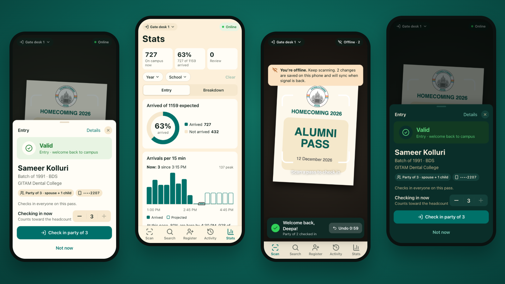

# Homecoming Check-in

### The whole reunion, checked in with one scan.

Point a phone at a pass and get a clear answer in a second. Keep going when the signal drops. Make sure no one is turned away and everyone is counted once. 
Built for **GITAM Homecoming 2026** (12 December 2026, Visakhapatnam), for the phones your volunteers already carry.

[Scanning](#one-scan-one-clear-answer) · [Offline](#works-when-the-signal-does-not) · [Search and walk-ins](#find-anyone-add-anyone) · [Mistakes](#mistakes-happen-and-it-is-fine) · [Live stats](#know-whats-happening-as-it-happens) · [Admin](#run-the-list-from-your-phone) · [Privacy](#private-by-design)

---

## Why it exists

Most of a reunion arrives in the same hour. Paper lists are slow, spreadsheets do not survive a crowded venue's Wi-Fi, and nobody wants an alumnus turned away at the gate or counted twice.

Homecoming Check-in replaces the clipboard with a phone. Every pass carries a QR code. Volunteers scan it at the gate, the app answers instantly, and the organisers watch the day unfold on a live dashboard.

| | | |
| --- | --- | --- |
| **An answer in a second** | **Never stuck** | **Everyone counted once** |
| The guest, their party and what to do next, in plain words and colour. | The guest list lives on the phone, so scanning works with no signal and catches up when it returns. | A party is checked in once, with a headcount, however many gates scan its pass. |

---

## One scan, one clear answer

Open the app, point the camera at a pass, and the result slides up before the guest has stopped walking. Green means go, amber means take a look, red means stop.

<table>
<tr>
<td align="center" valign="top" width="25%">
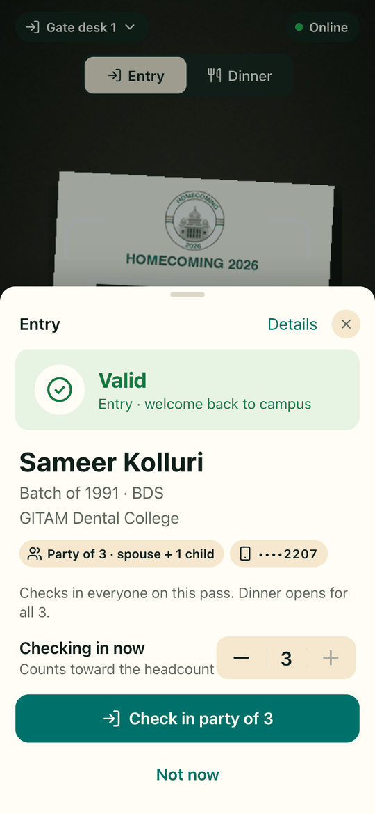 
<b>Point and scan</b> The camera reads the QR and opens the guest straight away.
</td>
<td align="center" valign="top" width="25%">
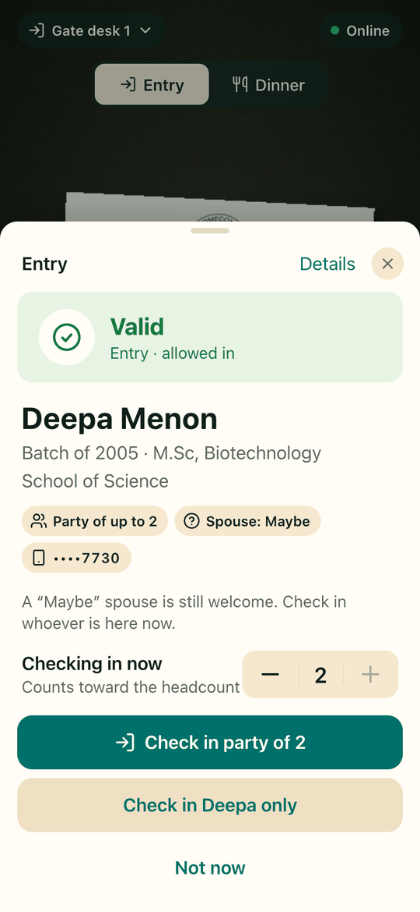 
<b>Whole party, or just one</b> The count starts at the party size on the pass. Change it to who actually turned up.
</td>
<td align="center" valign="top" width="25%">
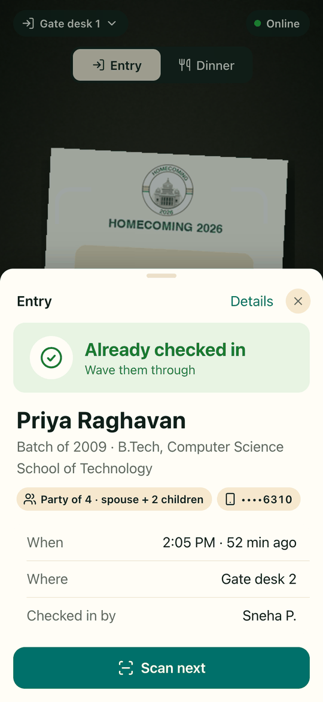 
<b>Already in? Wave them through</b> Shows when, where and who checked them in.
</td>
<td align="center" valign="top" width="25%">
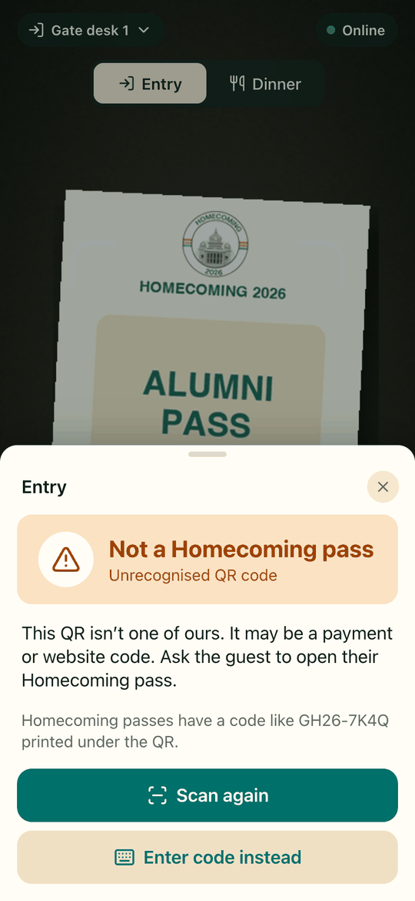 
<b>Not one of ours</b> A payment QR or a stranger’s code is turned away politely.
</td>
</tr>
</table>

No camera, or a pass that will not scan? **Enter code instead** takes the code printed under the QR, and Search finds anyone by name.

---

## Works when the signal does not

Event venues are where mobile networks go to die, so the app does not depend on one.

When a phone is set up, it downloads the whole guest list once and keeps it. Every scan after that is answered from the phone itself. Changes are saved on the phone and sent as soon as there is signal, and sending the same change twice never counts it twice.

<table>
<tr>
<td align="center" valign="top" width="33%">
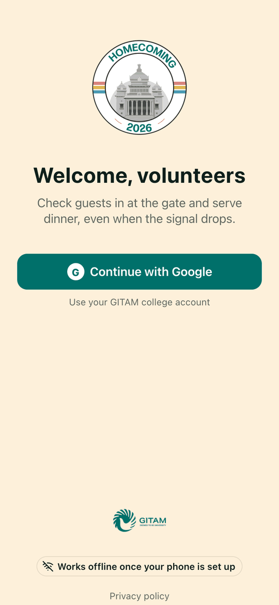 
<b>Sign in with Google</b> One tap with the college account.
</td>
<td align="center" valign="top" width="33%">
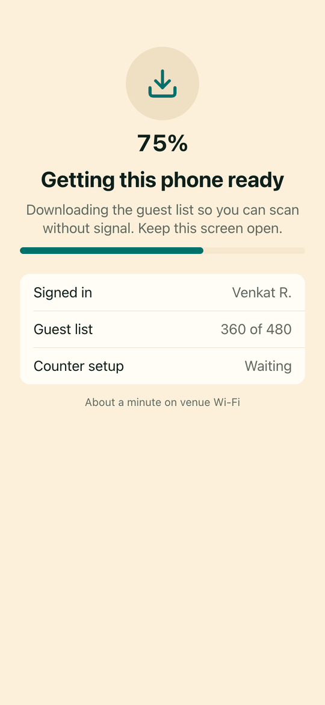 
<b>Getting this phone ready</b> About a minute on the venue Wi-Fi.
</td>
<td align="center" valign="top" width="33%">
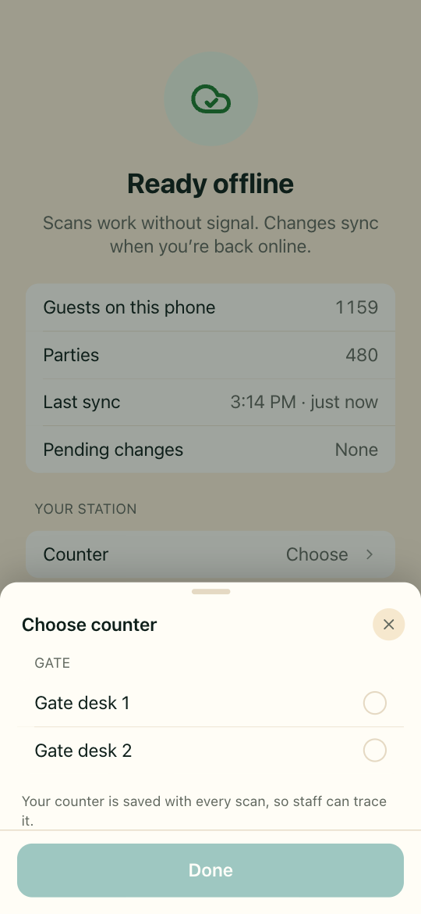 
<b>Pick your station</b> Your gate desk, remembered for next time.
</td>
</tr>
</table>

<table>
<tr>
<td align="center" valign="top" width="25%">
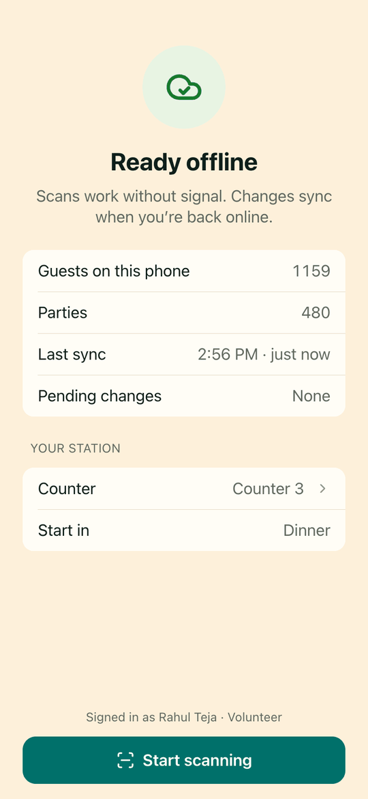 
<b>Ready offline</b> See what is on the phone and what is waiting to sync.
</td>
<td align="center" valign="top" width="25%">
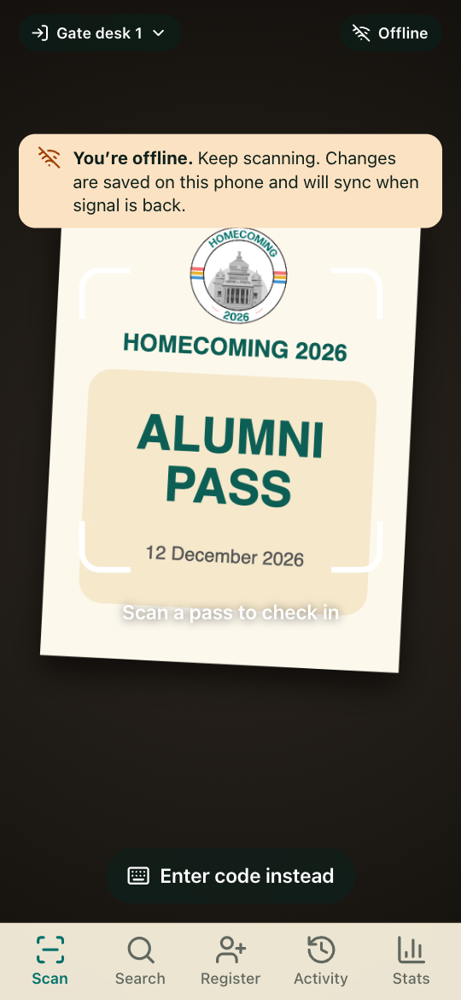 
<b>You are offline. Keep scanning.</b> A clear banner, and the scanner keeps working.
</td>
<td align="center" valign="top" width="25%">
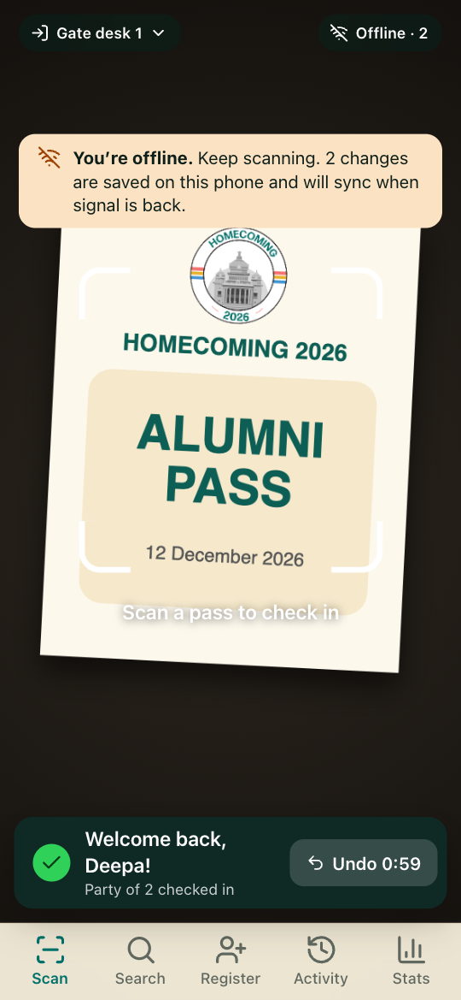 
<b>Changes are saved</b> The pill shows how many are waiting to sync.
</td>
<td align="center" valign="top" width="25%">
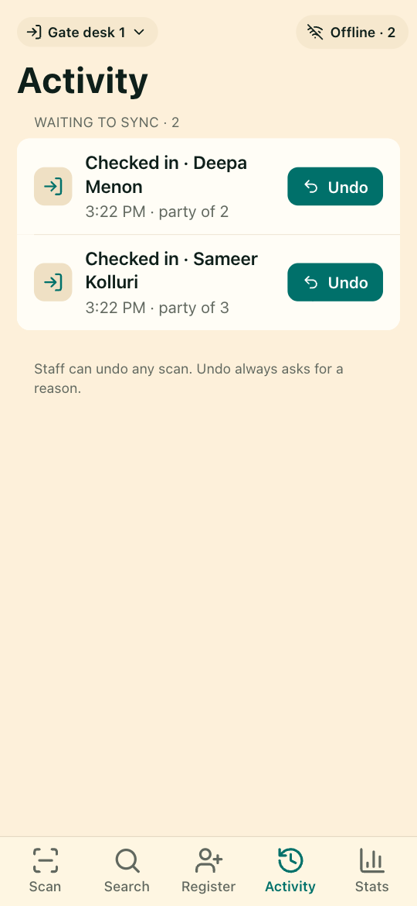 
<b>Waiting to sync</b> Everything scanned offline, listed and undoable.
</td>
</tr>
</table>

---

## Find anyone, add anyone

Guests lose passes, phones die and some alumni simply turn up. The app handles all three without a queue building.

<table>
<tr>
<td align="center" valign="top" width="25%">
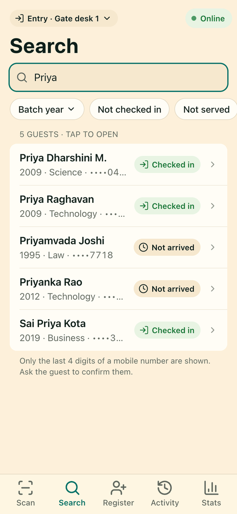 
<b>Search by name or code</b> Type a few letters. Only the last four digits of a mobile number are shown.
</td>
<td align="center" valign="top" width="25%">
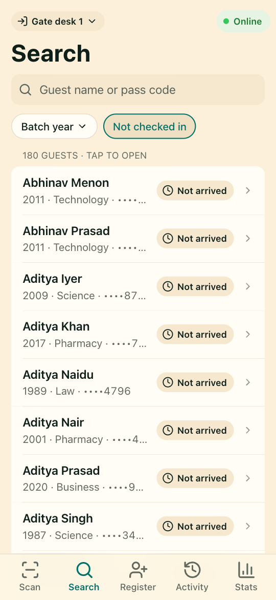 
<b>Filter the crowd</b> Batch year, and not checked in.
</td>
<td align="center" valign="top" width="25%">
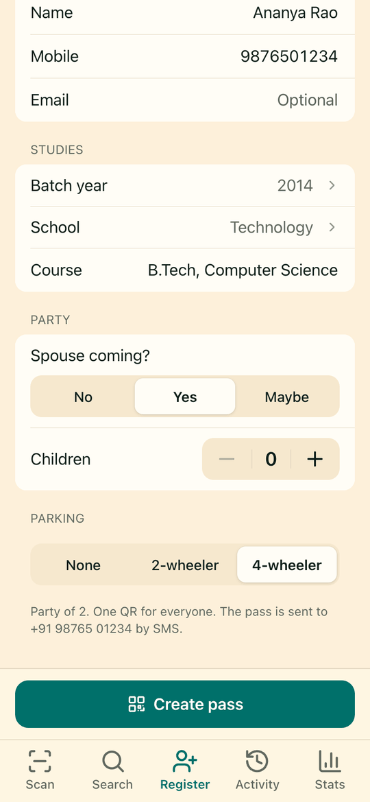 
<b>Register a walk-in</b> A short form for alumni who arrive without a pass. Parking included.
</td>
<td align="center" valign="top" width="25%">
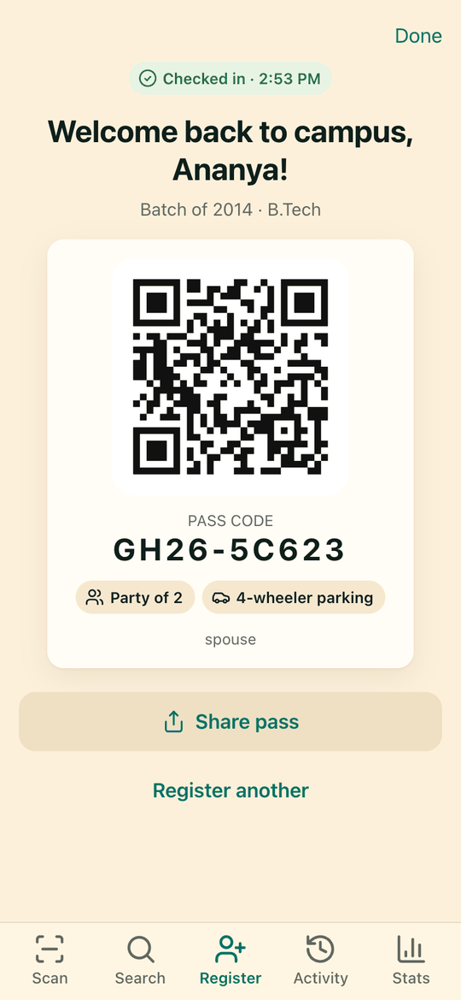 
<b>A pass on the spot</b> The new guest is checked in and gets their own QR code and pass code to share.
</td>
</tr>
</table>

A walk-in whose mobile number matches an existing guest is flagged for staff to review, never silently merged.

---

## Mistakes happen, and it is fine

Everyone taps the wrong guest at some point. The app expects it.

<table>
<tr>
<td align="center" valign="top" width="33%">
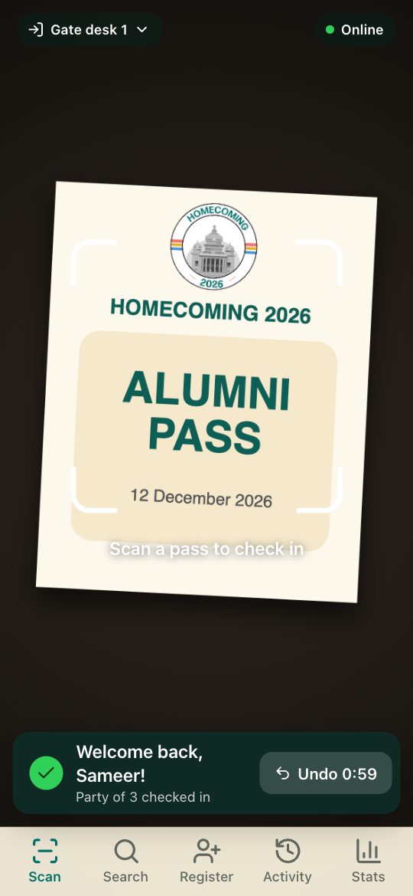 
<b>Undo in 60 seconds</b> Every scan shows a toast with a countdown. One tap takes it back.
</td>
<td align="center" valign="top" width="33%">
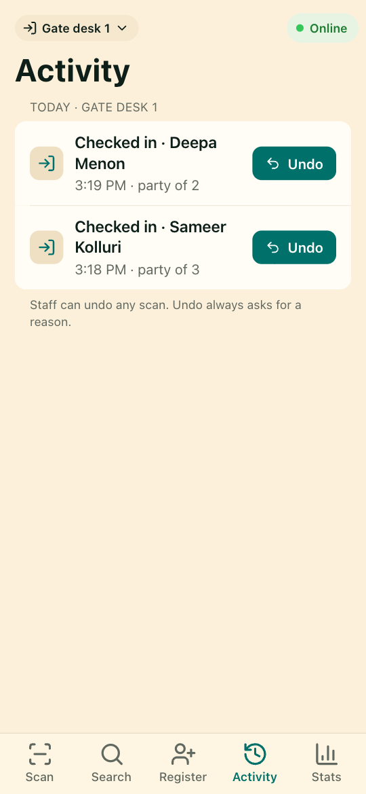 
<b>Everything this phone did</b> Each scan can be undone from the Activity tab.
</td>
<td align="center" valign="top" width="33%">
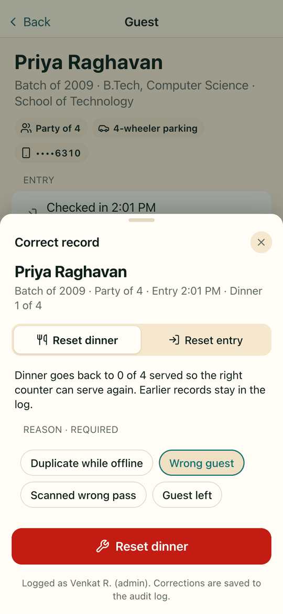 
<b>Staff can fix any record</b> Reset a guest’s check-in. A reason is required.
</td>
</tr>
</table>

Volunteers can undo their own scans. Staff can correct anyone’s, and must say why. Nothing is ever deleted: a correction is recorded as a new entry that points at the old one, so the history of the day stays honest.

---

## Know what’s happening, as it happens

Staff get a live dashboard built from every phone that has checked in. Tap the **Review** box and the app lists the parties that need a human to look.

<table>
<tr>
<td align="center" valign="top" width="50%">
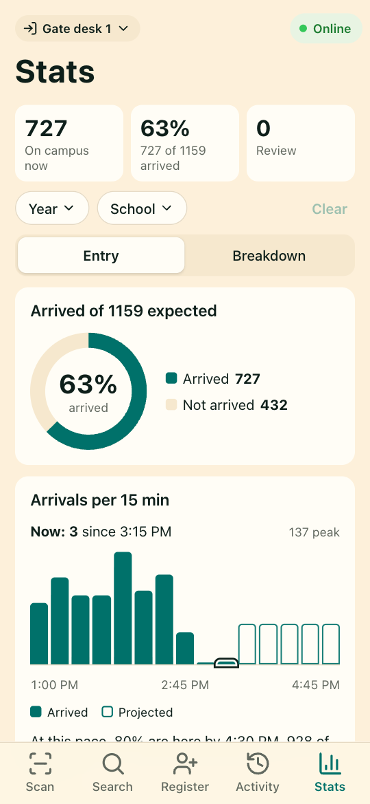 
<b>Arrivals</b> How many are here against how many are expected, and arrivals every 15 minutes.
</td>
<td align="center" valign="top" width="50%">
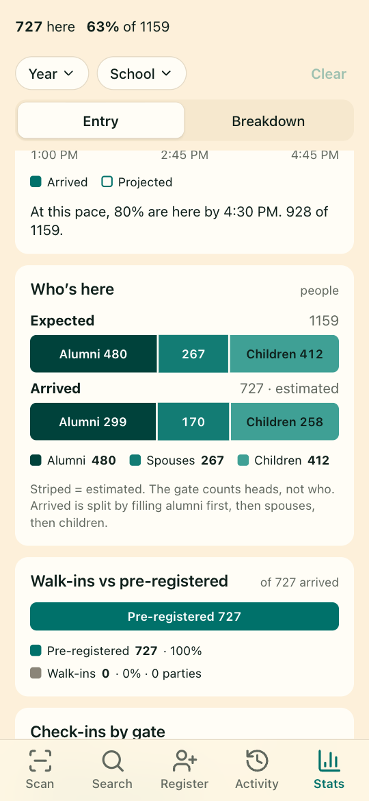 
<b>Who is here</b> A projection, walk-ins against pre-registered, and check-ins by gate.
</td>
</tr>
</table>

<table>
<tr>
<td align="center" valign="top" width="33%">
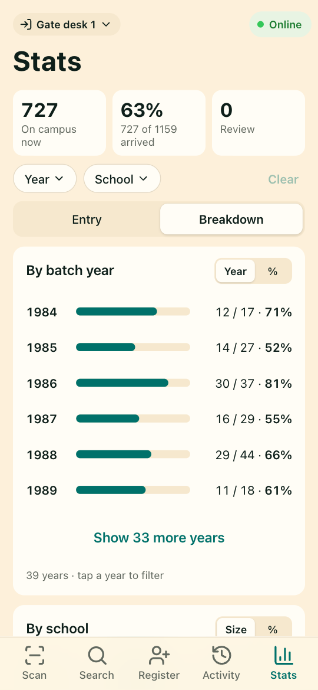 
<b>By batch year</b> Which years have turned up, and which have not.
</td>
<td align="center" valign="top" width="33%">
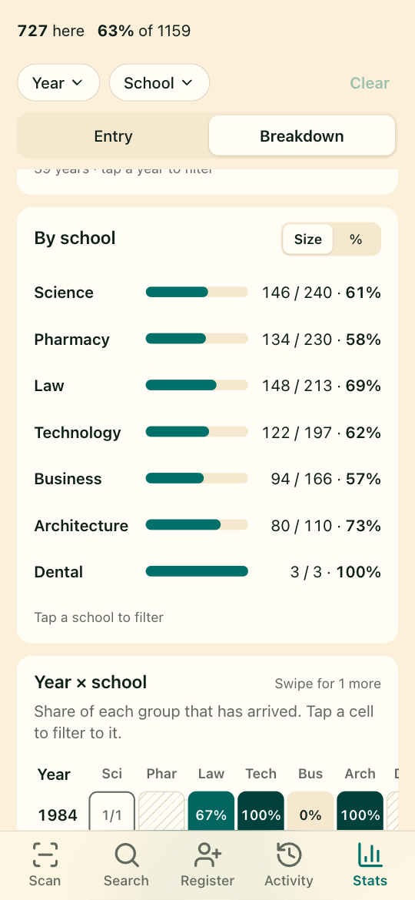 
<b>By school</b> Arrivals for each school. Tap one to filter.
</td>
<td align="center" valign="top" width="33%">
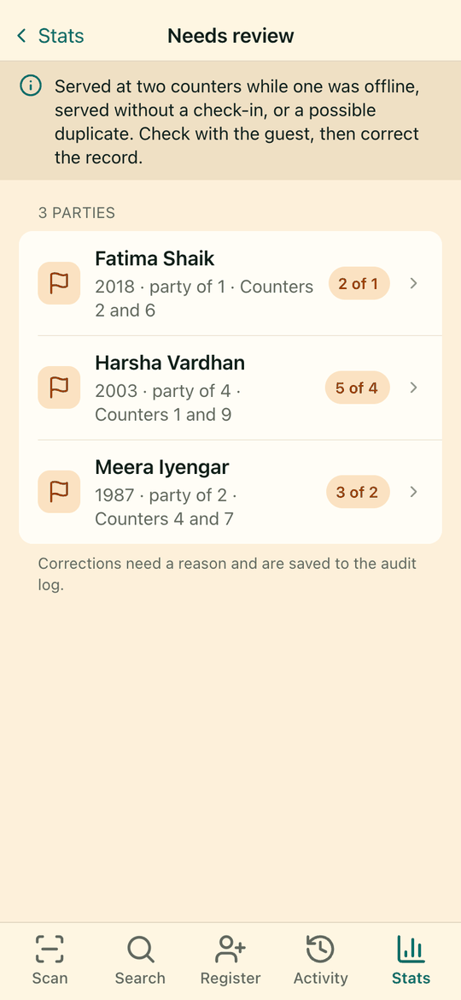 
<b>Needs review</b> Parties that may be listed twice, because they share a mobile number.
</td>
</tr>
</table>

A few details that matter on the day:

- **Estimates say they are estimates.** Where the gate counts heads rather than names, the split between alumni, spouses and children is shown as an estimate and labelled that way.
- **Filter by batch year or school** and the numbers follow.

---

## Run the list from your phone

Admins do not need a laptop or a database console. Everything below is in the app. A **Flush all check-ins** button (Account, then Danger zone) clears every check-in for a fresh start after a rehearsal: registrations stay, on-spot guests can be kept or removed, and it asks for a reason and a typed confirmation first.

<table>
<tr>
<td align="center" valign="top" width="33%">
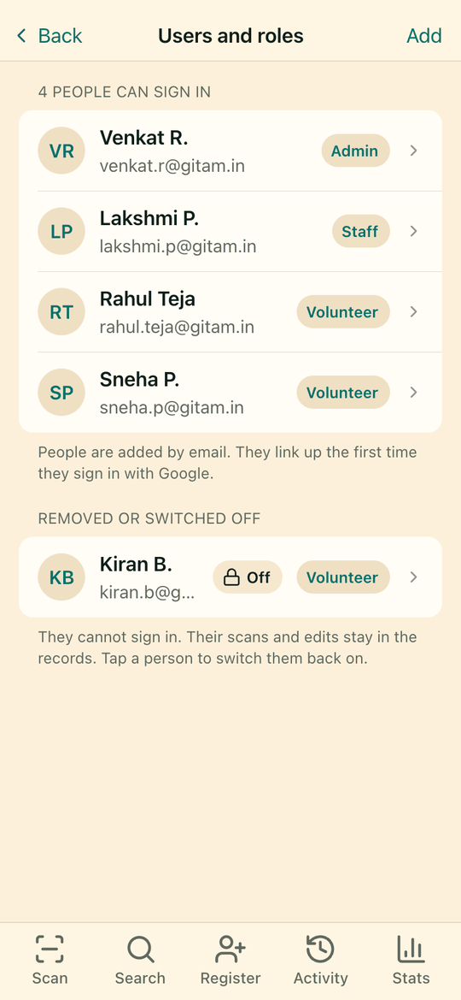 
<b>Who can sign in</b> Add people by email, set their role, switch them off. They link up the first time they sign in with Google.
</td>
<td align="center" valign="top" width="33%">
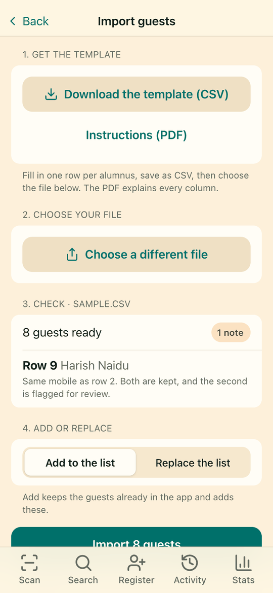 
<b>Import the guest list</b> Download the template, fill it in, choose the file. Every row is checked and the problems are named before anything is saved.
</td>
<td align="center" valign="top" width="33%">
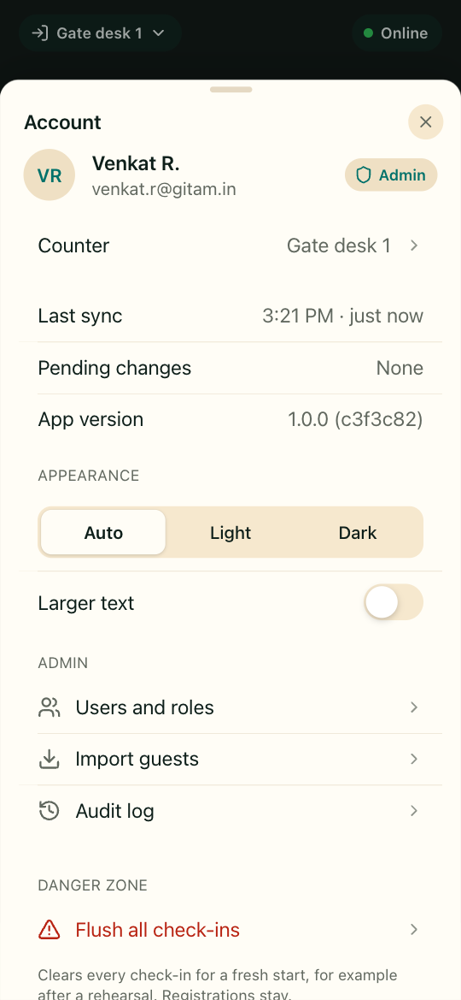 
<b>Your account</b> Counter, sync status, app version, light or dark, larger text.
</td>
</tr>
</table>

The import takes a plain CSV file, with a printable PDF guide to every column. It can **add** to the list or **replace** it, flags guests who share a mobile number instead of merging them, and handles up to 10,000 guests in one go. A separate export gives the organisers every guest’s pass code for sending passes out. Each export is recorded.

---

## Private by design

An alumni list is personal data, and the app is built to treat it that way.

<table>
<tr>
<td align="center" valign="top" width="50%">
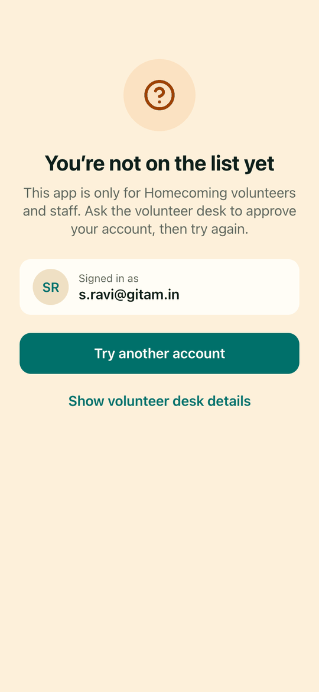 
<b>Only the team gets in</b> Sign-in is through Google. Anyone who is not on the approved list is turned away and sees no data.
</td>
<td align="center" valign="top" width="50%">
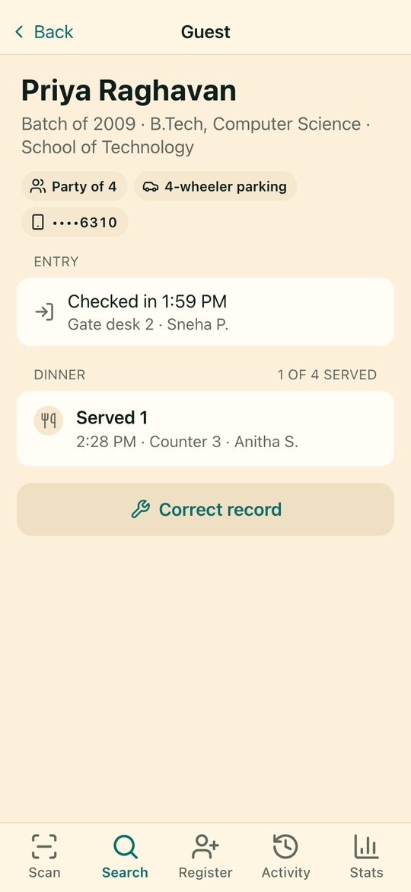 
<b>Last four digits only</b> Phones carry the last four digits of a mobile number, never the whole thing.
</td>
</tr>
</table>

- **Three roles, enforced by the database.** Volunteers, staff and admins see and do different things, and the rules live on the server, not only in the app.
- **Full contact details are kept apart.** Opening one is allowed for staff and above, and every lookup is written to an audit trail.
- **The server is the referee.** It rejects repeated sends, checks roles and applies the undo rules, whatever a phone claims.
- **Nothing is overwritten.** Scans are a permanent log. State is worked out from the log, never edited in place.
- There is a privacy page inside the app, linked from the sign-in screen.

---

## Easy on the eyes

Light, dark or automatic, with a larger-text option for long shifts. The gate in a dim hall looks as good as it does at noon.

<table>
<tr>
<td align="center" valign="top" width="25%">
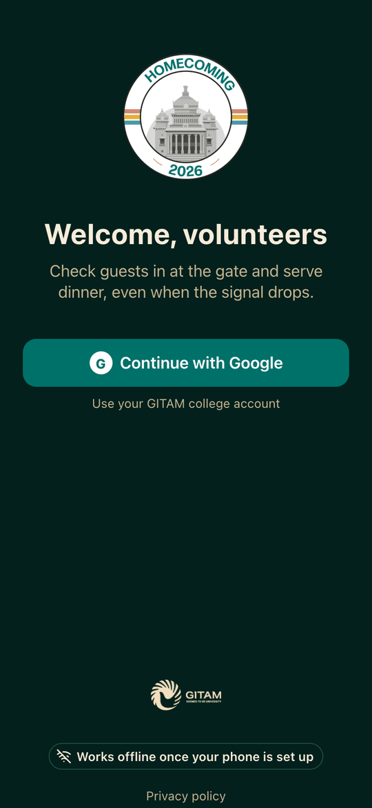 
<b>Sign-in</b> Follows the phone, or choose.
</td>
<td align="center" valign="top" width="25%">
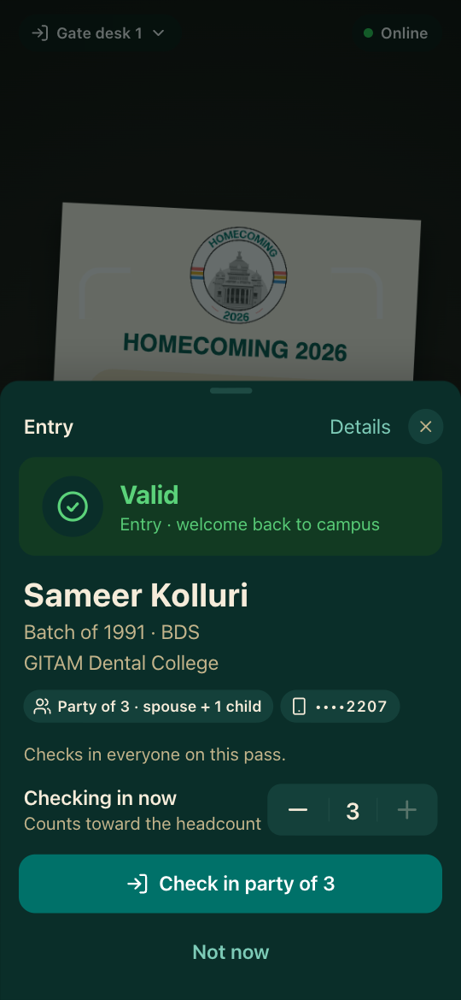 
<b>A scan result</b> Same colours, same clarity.
</td>
<td align="center" valign="top" width="25%">
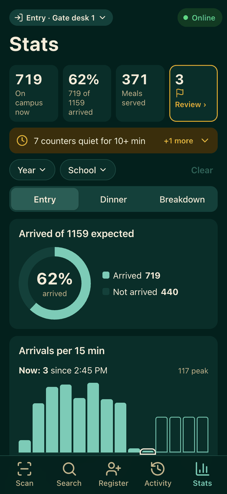 
<b>Stats</b> Charts redrawn for the dark.
</td>
<td align="center" valign="top" width="25%">
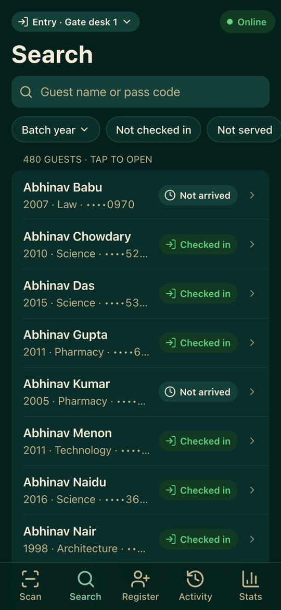 
<b>Search</b> Easy to read at the counter.
</td>
</tr>
</table>

---

## Who gets what

| | Volunteer | Staff | Admin |
| --- | :---: | :---: | :---: |
| Scan passes, search, register walk-ins | ✓ | ✓ | ✓ |
| Undo their own scans | ✓ | ✓ | ✓ |
| Undo anyone’s scan, correct records (with a reason) | | ✓ | ✓ |
| Live stats and the needs-review list | | ✓ | ✓ |
| Open a guest’s full contact details (logged) | | ✓ | ✓ |
| Manage who can sign in, import and export the guest list | | | ✓ |

---

## In numbers

- **187** automated tests cover the maths behind the stats, the undo rules, the counters and the phone’s local database.
- **140** database checks run against a real Postgres, signed in as real roles, on every change.
- A **5,000-guest** list loads in about a third of a second in those database tests.
- **No application servers** to look after: the app is static files plus a managed database.

---

## Under the hood

A React and TypeScript app that installs as a PWA, keeps its data in the phone’s own database, and talks to Supabase for Google sign-in and a Postgres database with row-level security. It is hosted on Vercel. Sign-in is limited to the event team, so there is no public demo. The app has a built-in demo mode with made-up guests, and every screenshot here comes from it.

Want the engineering detail?

- [Code walkthrough](docs/CODE_WALKTHROUGH.md): architecture, data model, every module, the SQL and how to run it.
- [Database setup](supabase/README.md): the schema, the security model and how to apply it.
- [Project context](CONTEXT.md): decisions, history and what is still to do.

All screenshots show the app’s demo mode with invented guests and staff. No real attendee data appears in this repository. The camera view in the scanner shots is a staged test feed pointed at a sample pass.
